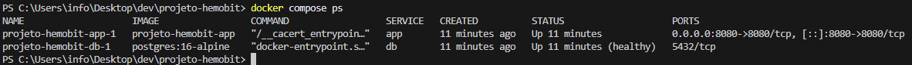
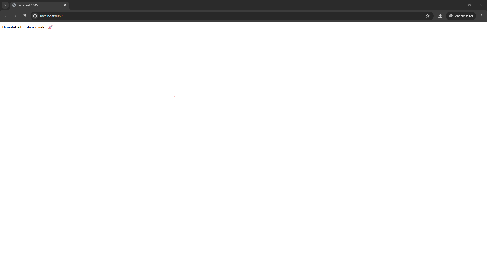
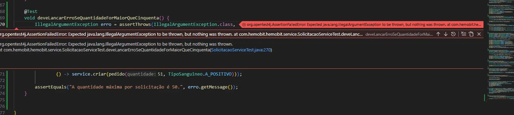
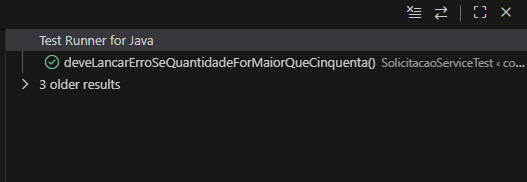
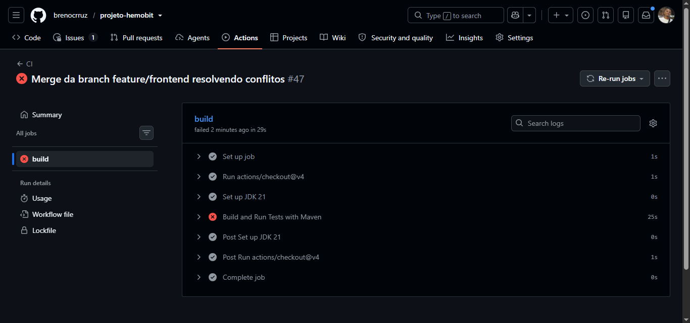
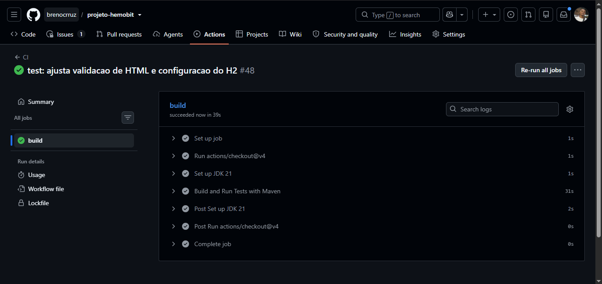

# 🩸 Hemobit

### Gestão e Distribuição Inteligente de Hemocomponentes

[](https://github.com/brenocrruz/projeto-hemobit/actions/workflows/ci.yml)
[](https://projeto-hemobit.onrender.com/)
[](https://openjdk.org/)
[](https://spring.io/projects/spring-boot)

Projeto desenvolvido para o **Projeto Integrador III — ADS 2026.2**, da **CESAR School**, integrando as disciplinas de **Programação Orientada a Objetos**, **Algoritmos e Estruturas de Dados**, **Estatística e Probabilidade**, **Infraestrutura de Software** e **Infraestrutura de Comunicação**.

---

## 📖 Sobre o Projeto

### O Problema

A rede de sangue precisa garantir o **componente certo** (compatível e dentro da validade), no **lugar certo**, no **tempo certo** e na **temperatura certa**. Falhas nesse processo geram:

- Desabastecimento de hemocomponentes.
- Descarte de bolsas por vencimento.
- Risco à vida do paciente.

Falta uma plataforma que integre **estoque**, **compatibilidade**, **roteirização** e **monitoramento da cadeia fria**.

### A Solução

O **Hemobit** é uma aplicação web que funciona como uma camada facilitadora entre o **profissional solicitante** (hospital) e a **operação do centro de hemocomponentes** (hemocentro). O sistema organiza o fluxo operacional e torna as informações mais acessíveis e rastreáveis, **sem substituir decisões clínicas**.

### Funcionalidades do MVP

- Cadastro e autenticação de usuários e hospitais.
- Cadastro e gestão de hemocomponentes (CH, CP, PFC).
- Controle de estoque e validade (FEFO).
- Chatbot dentro da aplicação web para solicitações.
- Criação e acompanhamento de requisições.
- Compatibilidade ABO/Rh didática.
- Grafo de rotas limitado com cálculo de caminho mínimo.
- Telemetria simulada (GPS, temperatura, timestamps).
- Dashboard operacional com indicadores estatísticos.
- Alertas de estoque, validade, atraso, desvio de rota e temperatura.

### Público-Alvo

| Perfil | Responsabilidades |
|--------|-------------------|
| **Profissional solicitante** | Usa o chatbot para consultar, iniciar e acompanhar solicitações. |
| **Funcionário do centro** | Analisa solicitações, consulta estoque, separa unidades, prepara e acompanha transportes. |
| **Gestor** | Acompanha indicadores, alertas, estoque e desempenho operacional. |

### Limites e Premissas

> ⚠️ **Projeto acadêmico e didático.** Uso exclusivo de **dados sintéticos** (LGPD). A compatibilidade ABO/Rh é **didática** e não substitui protocolos clínicos. GPS, temperatura e telemetria são **simulados**. O sistema não decide indicação de transfusão.

---

## 🏗️ Arquitetura

A aplicação segue uma arquitetura em camadas:

```
Usuário → Web/Chatbot → API REST → Regras de Negócio → Banco de Dados → Monitoramento → Dashboard/Estatística
```

### Estrutura do Repositório

```
projeto-hemobit/
├── src/main/java/com/hemobit/hemobit/
│   ├── aed/              # Algoritmos e Estruturas de Dados
│   ├── controller/       # Endpoints REST
│   ├── domain/           # Entidades JPA
│   ├── repository/       # Repositórios Spring Data
│   └── service/          # Regras de negócio
├── src/main/resources/
├── src/test/             # Testes automatizados
├── docs/
│   ├── historias_de_usuario.md
│   ├── poo/              # Documentação de POO
│   ├── aed/              # Documentação de AED
│   ├── rsd/              # Documentação de RSD
│   └── evidencias/       # Evidências de execução do Docker
├── data/                 # Dados sintéticos
├── .github/workflows/    # Pipeline CI/CD
├── .env.example          # Modelo das variáveis de ambiente
├── .gitignore            # Arquivos ignorados pelo Git
├── compose.yaml          # Orquestração dos containers
└── Dockerfile            # Build multi-stage da aplicação
```

---

## 🛠️ Tecnologias

| Camada | Tecnologia |
|--------|------------|
| Linguagem | Java 21 |
| Framework | Spring Boot 4.1.1 |
| Persistência | Spring Data JPA + PostgreSQL |
| Frontend | HTML / CSS / Thymeleaf |
| Build | Maven |
| CI/CD | GitHub Actions + Render |
| Containerização | Docker + Docker Compose |
| Testes | JUnit + H2 em memória |
| Ferramentas | Git, GitHub, Jira, Figma, draw.io |
> **Restrição:** Não é permitido o uso de Lombok ou qualquer mecanismo de geração automática de código boilerplate.

---

## 👥 Equipe

| Integrante | E-mail CESAR School |
|------------|---------------------|
| Breno Luiz de Lima Cruz | [bllc@cesar.school](mailto:bllc@cesar.school) |
| Davi Magno Campelo do Nascimento | [dmcn@cesar.school](mailto:dmcn@cesar.school) |
| Lauan Goncalves dos Santos | [lgs5@cesar.school](mailto:lgs5@cesar.school) |
| Letícia Gomes da Silva | [lgs6@cesar.school](mailto:lgs6@cesar.school) |
| Lucas Felipe Barreto Cavalcante | [lfbc@cesar.school](mailto:lfbc@cesar.school) |
| Lucas Filipe de Lima Segundo | [lfls@cesar.school](mailto:lfls@cesar.school) |
| Mateus Valerino Barros de Santana | [mvbs2@cesar.school](mailto:mvbs2@cesar.school) |

### Histórico da Equipe

| Integrante | E-mail | Entrada | Saída |
|------------|--------|---------|-------|
| Nenhum registro | — | — | — |

---

## 🚀 Como Rodar o Projeto

### Pré-requisitos

- **Docker** instalado.
- **Docker Compose** disponível e funcionando.
- **Git** instalado.

### Passo a Passo (Via Docker - Recomendado)

1. Certifique-se de ter o **Docker** e o **Docker Compose** instalados e rodando.
2. Clone o repositório:

```bash
git clone https://github.com/brenocrruz/projeto-hemobit.git
cd projeto-hemobit
```
3. Copie o arquivo de exemplo de variáveis:
```bash
cp .env.example .env
```
4. Abra o arquivo .env e preencha as variáveis POSTGRES_PASSWORD e SPRING_DATASOURCE_PASSWORD com a senha do banco (ex: hemobit123).:
5. Suba os containers com o comando:
```bash
docker compose up -d --build
```
6. A API estará disponível em http://localhost:8080.
> ⚠️ **Atenção** O arquivo .env não vem no repositório por questões de segurança (está no .gitignore). É obrigatório criar o seu próprio arquivo .env a partir do .env.example antes de rodar o projeto pela primeira vez.

## Comandos úteis do Docker

### Consultar o estado dos containers:
```bash
docker compose ps
```
### Acompanhar os logs da aplicação:
```bash
docker compose logs -f
```
### Acompanhar apenas os logs da API:
```bash
docker compose logs -f app
```
### Acompanhar apenas os logs da API:
```bash
docker compose down
```
> **Persistência:** O banco PostgreSQL utiliza o volume nomeado postgres_data. Os dados são preservados ao executar docker compose down. Para remover também o volume e apagar os dados persistidos, utilize docker compose down -v.

### Variáveis de Ambiente

O arquivo `.env.example` contém o modelo das variáveis necessárias para executar o projeto com Docker. Copie-o para `.env` e configure os valores localmente.

| Variável | Descrição |
|----------|-----------|
| `POSTGRES_PASSWORD` | Senha utilizada pelo PostgreSQL. |
| `SPRING_DATASOURCE_PASSWORD` | Senha utilizada pela aplicação para acessar o banco de dados. |

*(As duas variáveis de senha devem corresponder à mesma senha do banco de dados).*

Para o deploy, as seguintes variáveis são configuradas no Render:

| Variável | Descrição |
|----------|-----------|
| `SPRING_DATASOURCE_URL` | URL JDBC do PostgreSQL |
| `SPRING_DATASOURCE_USERNAME` | Usuário do banco |
| `SPRING_DATASOURCE_PASSWORD` | Senha do banco |

---

## ☁️ Deploy e CI/CD

A aplicação está implantada e acessível publicamente:

🔗 **[https://projeto-hemobit.onrender.com/](https://projeto-hemobit.onrender.com/)**

### Pipeline de CI/CD

O projeto utiliza **GitHub Actions** para integração contínua e **Render** para deploy automatizado.

```
git push (main) → GitHub Actions (build + test) → Deploy Hook → Render (Docker build + deploy)
```

- **Arquivo do pipeline:** [`.github/workflows/ci.yml`](.github/workflows/ci.yml)
- **Dockerfile:** [`Dockerfile`](Dockerfile)
- **Docker Compose:** [`compose.yaml`](compose.yaml)

---

## 📚 Disciplinas Integradas

O Hemobit é um projeto integrador: cada disciplina contribui com uma parte essencial do produto.

| Disciplina | Papel no Projeto | Artefatos |
|------------|------------------|-----------|
| **Programação Orientada a Objetos (POO)** | Constrói a aplicação web em Java/Spring Boot, modela o domínio e implementa as regras de negócio. | [Modelo de Domínio](./docs/poo/modelo-dominio.md) |
| **Algoritmos e Estruturas de Dados (AED)** | Projeta e implementa os algoritmos de roteirização, compatibilidade ABO/Rh e priorização FEFO. | [Escopo do Grafo](./docs/aed/escopo-grafo.md) |
| **Estatística e Probabilidade (EST)** | Transforma os dados de estoque, demanda e operação em indicadores e análises. | Em desenvolvimento |
| **Infraestrutura de Software (SO)** | Garante desempenho, concorrência, CI/CD e operação em nuvem. | [Pipeline CI/CD](./.github/workflows/ci.yml) |
| **Infraestrutura de Comunicação (RSD)** | Define a arquitetura de comunicação entre unidades e a telemetria dos veículos. | [Contratos de API](./docs/rsd/contratos-api.md) |

---

## 📦 Entregas — Programação Orientada a Objetos

> As entregas abaixo são referentes à disciplina de **Programação Orientada a Objetos**. Os artefatos das demais disciplinas estão listados na seção **Disciplinas Integradas**.

### 🟢 Entrega 01 — Histórias de Usuário e Protótipo Lo-Fi

**Data:** 31/08/2026

- **7 Histórias de Usuário** com cenários BDD.
- **Protótipo Lo-Fi** no Figma (mínimo 5 histórias).
- **Screencast** de apresentação do protótipo.

| Artefato | Link |
|----------|------|
| Histórias de Usuário + BDD | [docs/historias_de_usuario.md](./docs/historias_de_usuario.md) |
| Protótipo Lo-Fi (Figma) | [Acessar](https://www.figma.com/design/2i20Xk8HdRaHD5qzrYGwvJ/Untitled?node-id=0-1&p=f&t=owGOIf38YrcZiYnx-0) |
| Screencast | [Assistir no YouTube](https://youtu.be/DexqcjN694o) |

**Histórias contempladas:**

| ID | História |
|----|----------|
| HU01 | Cadastro e Gestão de Profissionais Solicitantes |
| HU02 | Cadastro e Manutenção de Hospitais Solicitantes |
| HU03 | Cadastro do Acervo de Hemocomponentes |
| HU04 | Registro e Entrada de Bolsas de Sangue no Estoque |
| HU05 | Consulta e Listagem do Estoque do Hemocentro |
| HU06 | Criação de Solicitação de Hemocomponentes |
| HU07 | Atualização do Status da Solicitação |

---
### 🟢 Entrega 02 — Implementação de Histórias (Parte 1)

**Data:** 21/09/2026

> As entregas abaixo são referentes à disciplina de Programação Orientada a Objetos. Os artefatos das demais disciplinas estão listados na seção Disciplinas Integradas.

#### 📌 Histórias de Usuário Implementadas

- **HU01 — Cadastro e Gestão de Profissionais Solicitantes**
  - Cadastro de profissionais solicitantes.
  - Consulta, atualização e exclusão de profissionais.
  - Validação de CRM/matrícula duplicado.

- **HU02 — Cadastro e Manutenção de Hospitais Solicitantes**
  - Cadastro de hospitais/unidades de saúde.
  - Consulta, atualização e exclusão de unidades.
  - Validação de CNPJ antes da persistência.
  - Bloqueio de cadastro com CNPJ inválido.

#### 🔀 Controle de Versão e Acompanhamento

- Commits de código realizados na branch `main`.
- Uso do issue/bug tracker do GitHub para acompanhamento das atividades.

#### 🎥 Screencasts

- **Demonstração do sistema**
  - Apresentação do funcionamento das duas User Stories.
  - Demonstração dos cenários positivos e negativos.
  - Execução da aplicação Spring Boot e utilização dos endpoints.
  - [▶️ Assistir ao screencast — Demonstração do sistema](https://youtu.be/uAxWwdji9dM)

- **Explicação do código**
  - Apresentação da implementação das duas User Stories.
  - Explicação das entidades, repositories, services e controllers.
  - Apresentação das regras de negócio e validações implementadas.
  - [▶️ Assistir ao screencast — Explicação do código](https://youtu.be/JKPvnHs35X8)


**Documentação técnica (POO):**
- [Modelo de domínio](docs/poo/modelo-dominio.md)
- [Padrão de projeto aplicado (DTO)](docs/poo/padroes-projeto.md)

---
### 🟠 Entrega 03 — Implementação de Histórias (Parte 2)

**Data:** 19/10/2026

#### 📌 Histórias implementadas

> **HU06 — Criação de Solicitação de Hemocomponentes**
>
> **Como** profissional solicitante, **quero** registrar uma requisição de hemocomponentes para o meu hospital, **para** dar início ao atendimento.
>
> - **Entrega:** `POST /solicitacoes` com hospital, tipo de hemocomponente, tipo sanguíneo do paciente, quantidade de bolsas e prioridade (rotina, urgente ou emergência).
> - **Regras:** quantidade inteira de no mínimo 1 bolsa; todos os campos obrigatórios; hospital precisa existir. Nada é gravado se algo estiver errado.
> - **Resultado:** solicitação criada como `PENDENTE`, com código de identificação (`id`) e primeira linha no histórico.
> - **Erros:** 400 com mensagem clara, por exemplo "A quantidade solicitada deve ser de no mínimo 1 bolsa.".

> **HU07 — Atualização do Status da Solicitação pelo Centro Operacional**
>
> **Como** funcionário do centro, **quero** alterar o status das solicitações e atender os pedidos, **para** manter os hospitais informados sobre o andamento.
>
> - **Entrega:** `PUT /solicitacoes/{id}/status` (iniciar separação, cancelar, negar), `PUT /solicitacoes/{id}/atender`, `GET /solicitacoes/{id}/historico` e `GET /solicitacoes/{id}/bolsas`.
> - **Regras:** o pedido só anda para frente (`PENDENTE` → `EM_SEPARACAO` → `ATENDIDA`, `CANCELADA` ou `NEGADA`); pedidos finalizados não mudam mais; toda mudança grava quem fez e quando.
> - **Atendimento:** reserva as bolsas compatíveis (ABO/Rh, módulo do AED) que vencem primeiro (FEFO), ignorando bolsas vencidas. Se faltar bolsa compatível, responde 409 e nada é alterado.
> - **Erros:** 409 "Não é permitido alterar o status de solicitações já finalizadas." e "Estoque compatível insuficiente…".

#### 🧪 Testes automatizados

- `SolicitacaoServiceTest`: cenários da HU06 e da HU07 (validações, transições, histórico, atendimento FEFO + ABO/Rh, falta de estoque).
- `CompatibilidadeServiceTest`: os 64 pares receptor × doador conferidos contra a regra ABO/Rh.

#### 🔀 Controle de Versão e Acompanhamento

- Commits de código realizados na branch `main`, com frequência semanal.
- Issues/bug tracker do GitHub atualizados: [Ver issues](https://github.com/brenocrruz/projeto-hemobit/issues)

#### 🎥 Screencasts

- **Demonstração do sistema:** [▶️ Assistir](https://www.youtube.com/watch?v=NEd4m9DlYlM)
- **Explicação do código:** [▶️ Assistir](https://youtu.be/ns5ApMgaIzk)

#### 🖼️ Print da tela


**Documentação técnica (POO):**
- [Modelo de domínio](docs/poo/modelo-dominio.md)
- [Backlog da Unidade 2](docs/poo/backlog-u2.md)
- [Dados e roteiro de demonstração](docs/poo/demo-entrega-03.md)

---

### 🔴 Entrega 04 — Implementação de Histórias (Parte 3) e Apresentação Final

**Data:** 09/11/2026

> 🚧 Em desenvolvimento.

---

---

## 📦 Entregas — Infraestrutura de Software (SO)

> As entregas abaixo são referentes à disciplina de **Infraestrutura de Software**.

### 🟢 Unidade 2 Desafios PI - Parte 1 (Em Grupo) - Containerização

#### 🐳 E1 · Container Automatizado

O projeto sobe do zero com um comando (`docker compose up -d --build`), garantindo que rode igual em qualquer máquina.

- **Dockerfile multi-stage:** O primeiro estágio compila o código e roda os testes; o segundo leva apenas o artefato final (JRE Alpine) para deixar a imagem leve e segura.
- **Isolamento de Credenciais:** Uso de arquivo `.env` local para senhas e `.env.example` no repositório. O `.gitignore` impede o vazamento de segredos.
- **Banco de Dados:** Utilização de volume nomeado (`postgres_data`) para persistência e `healthcheck` para garantir que a API só suba após o banco estar pronto (usando `depends_on`).

#### ⚙️ Decisões de Arquitetura (E1)

| Decisão | Opções comuns | Justificativa |
| :--- | :--- | :--- |
| **Imagem base (build)** | `maven:3.9-eclipse-temurin-21`, `openjdk:21` | Usamos a imagem oficial do Maven com JDK 21, que já traz as ferramentas de compilação necessárias. |
| **Imagem base (runtime)** | `eclipse-temurin:21-jre-alpine`, `openjdk:21-slim` | `alpine` é menor e tem menos pacotes vulneráveis; como o build já foi feito no estágio anterior, só precisamos do JRE para rodar. |
| **Multi-stage** | Build único vs. multi-stage | Multi-stage deixa a imagem final menor (sem Maven e código-fonte) e mais segura. |
| **Dados** | Volume nomeado vs. bind mount | Volume nomeado (`postgres_data`): os dados sobrevivem ao `docker compose down` e ficam gerenciados pelo Docker. |
| **Rede** | Rede padrão do Compose vs. rede customizada | A rede padrão já resolve a comunicação pelo nome do serviço (`db`); não precisamos de configuração extra. |
| **Segredos** | `.env` no repositório vs. `.env.example` + `.env` local | O `.env` real fica no `.gitignore`; o `.env.example` serve de modelo e não contém senhas. |
| **Testes no Build** | Rodar local vs. no container | Os testes rodam no estágio de build do Dockerfile. Para testes de integração, configuramos o banco H2 em memória (`application.properties` na pasta test), garantindo que os testes passem mesmo sem um PostgreSQL externo durante o build. |

#### 📸 Evidências de Execução (E1)

*Print do terminal mostrando os containers rodando (`docker compose ps`):*


*Print do navegador mostrando a API respondendo:*


#### 🤖 Uso de IA (E1)
A IA foi utilizada para rascunhar o `Dockerfile`, o `compose.yaml`, auxiliar na configuração do banco de dados H2 para os testes e na formatação deste README. Todo o código, comandos e textos gerados foram revisados, testados e validados pelo grupo antes de serem commitados.

---

### 🧪 E2 · TDD (Test-Driven Development)

#### 🗺️ Story Map (Release 1)

**Backbone (Jornada do Usuário):** Cadastrar Hospital → Gerenciar Estoque → Solicitar Hemocomponentes → Atender Solicitação → Rastrear Transporte.

**Histórias da Release 1 (quebradas em tarefas):**

**HU06 — Criação de Solicitação de Hemocomponentes**
- [x] Tarefa 1: Validar se a quantidade solicitada é maior ou igual a 1.
- [x] Tarefa 2: Validar se o hospital informado existe no banco de dados.
- [x] Tarefa 3: Gravar a solicitação com o status inicial `PENDENTE`.
- [x] Tarefa 4: Registrar a data e hora da criação no histórico.

**HU07 — Atualização do Status da Solicitação**
- [x] Tarefa 1: Permitir transição apenas de `PENDENTE` para `EM_SEPARACAO`.
- [x] Tarefa 2: Bloquear alteração de status se a solicitação já estiver `ATENDIDA` ou `CANCELADA`.
- [x] Tarefa 3: Registrar no histórico quem alterou o status e quando.

**HU03 — Cadastro do Acervo de Hemocomponentes**
- [ ] Tarefa 1: Validar se o tipo sanguíneo (ABO/Rh) é válido.
- [ ] Tarefa 2: Salvar a data de validade da bolsa.
- [ ] Tarefa 3: Impedir o cadastro de bolsas já vencidas.

#### 🥒 Cenário de Aceitação (BDD / Gherkin) - HU06

Abaixo está o teste de aceitação escrito em Gherkin para a criação de solicitações. Ele garante que o fluxo principal e as validações de erro funcionem como o esperado.

- **Funcionalidade:** Criação de Solicitação de Hemocomponentes
  - **Como** profissional solicitante
  - **Quero** registrar uma requisição de hemocomponentes
  - **Para** dar início ao atendimento no hemocentro

- **Cenário: Solicitação criada com sucesso**
  - **Dado** que o hospital "Hospital da Restauração" está cadastrado
  - **Quando** eu solicito 2 bolsas de hemácias com prioridade URGENTE
  - **Então** a solicitação deve ser registrada com o status "PENDENTE"
  - **E** um histórico inicial deve ser gerado

- **Cenário: Tentativa de solicitar quantidade inválida**
  - **Dado** que o hospital "Hospital da Restauração" está cadastrado
  - **Quando** eu tento solicitar 0 bolsas de hemácias
  - **Então** o sistema deve recusar a solicitação
  - **E** deve exibir a mensagem "A quantidade solicitada deve ser de no mínimo 1 bolsa."

#### 🔄 Histórico Red → Green (Git)

Para comprovar a prática do TDD, utilizamos o padrão de commits:
1. `test: adiciona teste para limite maximo de 50 bolsas (RED)` - O teste falhou, pois a regra ainda não existia no código.
2. `feat: implementa limite maximo de 50 bolsas por solicitacao (GREEN)` - A regra foi implementada e o teste passou.

#### Evidência visual do ciclo TDD:

*Print do teste falhando (RED):*


*Print do teste passando (GREEN):*


#### 🚦 Testes na Esteira (GitHub Actions)

Configuramos o pipeline para rodar todos os testes a cada `push` e `pull request`. O bloqueio de merge foi ativado na branch `main`, garantindo que códigos com falhas não sejam integrados.

**1. Execução Vermelha (Pipeline barrou o merge por falha nos testes):**


**2. Execução Verde (Todos os testes passaram e a esteira liberou o merge):**


### 🟢 Deploy Automatizado (E3)

O projeto possui deploy contínuo configurado para a nuvem, garantindo que cada merge na branch `main` chegue ao ambiente público de forma automática e segura.

- **Ferramenta CI/CD:** GitHub Actions.
- **Provedor de Deploy:** Render (Docker).
- **Fluxo de Automação:** Push na `main` → GitHub Actions (Build + Testes) → Deploy Hook → Render.
- **Segurança de Credenciais:** A URL do Deploy Hook está protegida no *GitHub Secrets* (`RENDER_DEPLOY_HOOK_URL`) e as senhas do banco de produção estão isoladas nas variáveis de ambiente do Render.

#### 📸 Evidências do Deploy (E3)

**1. URL Pública (Sistema no ar):**
🔗 **[https://hemobit.onrender.com](https://hemobit.onrender.com)**


**2. Pipeline Vermelho (Bloqueando deploy por falha nos testes):**
*Print da esteira falhando e impedindo a publicação da imagem com erro:*


**3. Processo de Rollback**
Para reverter para uma versão anterior em caso de falha crítica em produção, acesse o painel do Render, navegue até a aba **Deploys**, encontre a versão estável anterior e clique em **Rollback**.

## 🔗 Links Úteis

- 🐙 [Repositório GitHub](https://github.com/brenocrruz/projeto-hemobit)
- 📋 [Jira (Board do Projeto)](https://algs2.atlassian.net/jira/software/c/projects/PI3E4/boards/11/backlog)
- 🎨 [Protótipo no Figma](https://www.figma.com/design/2i20Xk8HdRaHD5qzrYGwvJ/Untitled?node-id=0-1&p=f&t=owGOIf38YrcZiYnx-0)
- 🎥 [Screencast no YouTube](https://youtu.be/DexqcjN694o)

---

## 📄 Licença

Projeto acadêmico desenvolvido para a **CESAR School** — sem fins comerciais. Uso exclusivo de **dados sintéticos**.
