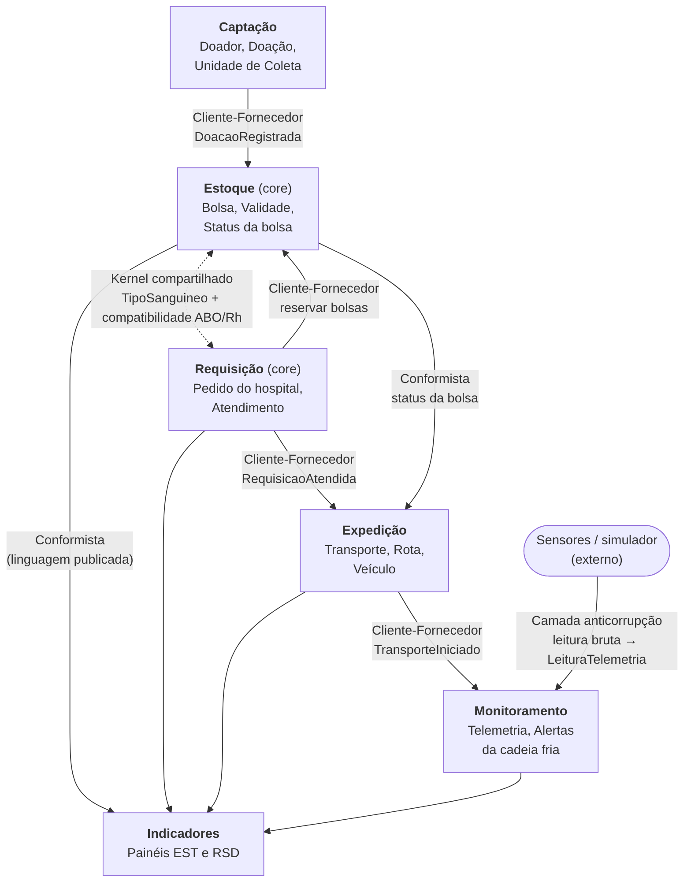
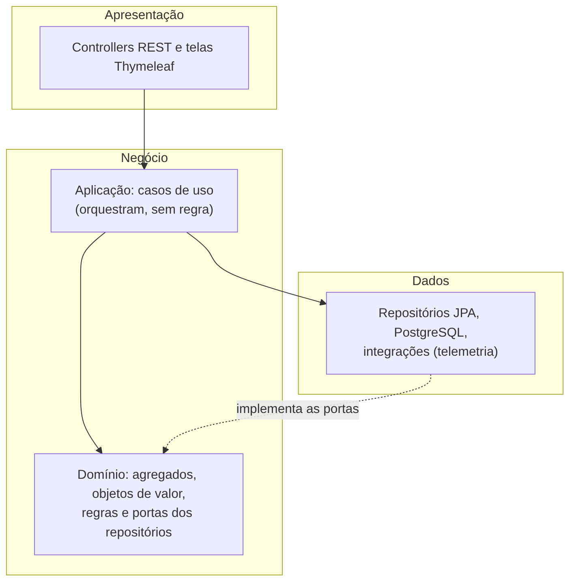

# Rota Vital: planejamento da remodelagem (versão parcial: seções A e C)

**Squad:** Grupo 5, ADS, CESAR School · **Repositório:** https://github.com/brenocrruz/projeto-hemobit
**Integrantes:** Breno Luiz de Lima Cruz, Davi Magno Campelo do Nascimento, Lauan Goncalves dos Santos, Letícia Gomes da Silva, Lucas Felipe Barreto Cavalcante, Lucas Filipe de Lima Segundo, Mateus Valerino Barros de Santana

**Estado deste documento:** pré-entrega para devolutiva em sala. Contém as seções A e C. As seções B, D e E (modelo tático, microsserviços, cenários com orçamento) estão em elaboração para a entrega final.

## A. Remodelagem do domínio com DDD

### A.1 Subdomínios

O Rota Vital distribui hemocomponentes de hemocentros para hospitais. O que diferencia o sistema é decidir **qual bolsa atende qual paciente, com segurança e sem desperdício**, e entregá-la com a cadeia fria íntegra.

| Subdomínio | Classe | Justificativa |
|---|---|---|
| Atendimento de requisições | **Core** | É a regra que o projeto vende: escolher a bolsa compatível (ABO/Rh) e mais próxima do vencimento (FEFO) e reservá-la sem duplicidade. |
| Estoque e validade | **Core** | A vida útil curta de cada hemocomponente e o ciclo de status da bolsa são regras específicas deste negócio, e o atendimento depende delas. |
| Logística e rotas | Suporte | Necessária para entregar, mas o grafo de rotas e o cadastro de veículos são problemas conhecidos, sem diferencial competitivo. |
| Monitoramento da cadeia fria | Suporte | Gera alertas de temperatura durante o transporte; apoia a segurança, mas não decide o atendimento. |
| Captação (doadores e doações) | Suporte | Alimenta o estoque; o cadastro segue fluxo administrativo comum. |
| Indicadores e análise | Suporte | Painéis de estoque, demanda e tempos leem dados dos outros contextos e não têm regra própria. |
| Identidade e acesso | Genérico | Autenticação e perfis são resolvidos por soluções prontas (ainda não implementado no projeto). |
| Notificação e chatbot | Genérico | Envio de avisos e atendimento por conversa podem usar serviços prontos. |
| Hospedagem e observabilidade | Genérico | Docker, Render, GitHub Actions e métricas são infraestrutura padrão. |

### A.2 Bounded contexts

| Contexto | Responsabilidade (uma frase) |
|---|---|
| **Estoque** | Guarda cada bolsa com seu código, validade e status, e garante que só bolsa disponível e dentro da validade possa ser reservada. |
| **Requisição** | Recebe o pedido do hospital e o atende escolhendo bolsas compatíveis pela ordem de validade, registrando o histórico de status. |
| **Expedição** | Planeja a rota, escolhe o veículo e acompanha o transporte das bolsas reservadas até o hospital. |
| **Captação** | Cadastra doadores, doações e unidades de coleta, e entrega ao Estoque a origem de cada bolsa. |
| **Monitoramento** | Recebe leituras de temperatura e posição durante o transporte e emite alerta quando a cadeia fria é rompida. |
| **Indicadores** | Reúne, sem alterar, os dados dos demais contextos para os painéis de estoque, demanda e tempo de atendimento. |

### A.3 Glossário da linguagem ubíqua

Os nomes em código estão entre parênteses quando diferem do termo de negócio.

| Termo | Contexto | Significado |
|---|---|---|
| **Bolsa** | Estoque | Unidade física de hemocomponente, com código único, validade e status (`Hemocomponente` no código). |
| **Bolsa** | Expedição | Item de carga de um transporte: interessa o destino, a temperatura exigida e o horário de entrega, não a validade. |
| **Bolsa** | Requisição | Item reservado para atender um pedido; só importa se é compatível e quantas faltam. |
| **Tipo sanguíneo** | Captação | Grupo ABO/Rh do doador, informado na doação. |
| **Tipo sanguíneo** | Estoque | Grupo da bolsa, herdado do doador da doação de origem. |
| **Tipo sanguíneo** | Requisição | Grupo do paciente (receptor), que decide a compatibilidade. |
| **Status** | Estoque | Situação da bolsa: Disponível, Reservado, Transportando, Utilizado, Vencido ou Descartado. |
| **Status** | Requisição | Situação do pedido: Pendente, Em separação, Atendida, Cancelada ou Negada. |
| Hemocomponente (tipo) | Estoque | Categoria do produto: concentrado de hemácias, plaquetas, plasma, crioprecipitado, sangue total. |
| Código da bolsa | Estoque | Identificador único, sempre em maiúsculas e sem espaços nas pontas. |
| Validade | Estoque | Data limite de uso; bolsa vencida não pode ser reservada. |
| FEFO | Requisição | "Primeiro que vence, primeiro que sai": entre as bolsas compatíveis, usa-se a mais próxima do vencimento. |
| Compatibilidade ABO/Rh | Requisição e Estoque | Regra didática que diz quais bolsas um paciente pode receber (matriz 8x8 do módulo de AED). |
| Reserva | Estoque | Ato de separar uma bolsa para um pedido; a bolsa passa a Reservada e fica ligada à requisição. |
| Requisição (`Solicitacao`) | Requisição | Pedido de um hospital por determinada quantidade de um hemocomponente para um paciente. |
| Prioridade | Requisição | Urgência do pedido: rotina ou emergência. |
| Atendimento | Requisição | Ato de reservar as bolsas e concluir o pedido, registrando a data. |
| Doação | Captação | Coleta de sangue de um doador, em uma unidade de coleta, da qual saem as bolsas. |
| Unidade de saúde | Requisição e Expedição | Hospital que pede e recebe as bolsas. |
| Rota | Expedição | Caminho entre origem e destino, com distância e tempo estimado. |
| Cadeia fria | Monitoramento | Faixa de temperatura que deve ser mantida do estoque até o hospital. |
| Alerta de temperatura | Monitoramento | Aviso gerado quando uma leitura sai da faixa permitida. |

### A.4 Mapa de contextos



| Relação | Tipo | Como funciona |
|---|---|---|
| Captação → Estoque | Cliente-Fornecedor | Captação é a fornecedora: cada doação registrada origina bolsas no Estoque. |
| Requisição → Estoque | Cliente-Fornecedor | Requisição é cliente: pede a reserva de bolsas e aceita as regras de disponibilidade que o Estoque define. |
| Estoque ↔ Requisição | Kernel compartilhado | Os dois usam o mesmo `TipoSanguineo` e a mesma matriz de compatibilidade ABO/Rh, mantidos em um único lugar. |
| Requisição → Expedição | Cliente-Fornecedor | Um pedido atendido dispara o planejamento do transporte. |
| Estoque → Expedição | Conformista | Expedição aceita o modelo de status da bolsa do Estoque sem traduzi-lo. |
| Expedição → Monitoramento | Cliente-Fornecedor | O início de um transporte diz ao Monitoramento o que acompanhar. |
| Sensores → Monitoramento | Camada anticorrupção | A leitura bruta do sensor (ou do simulador) é traduzida para `LeituraTelemetria`, protegendo o domínio do formato externo. |
| Demais → Indicadores | Conformista | Indicadores consome os dados como estão publicados e não influencia os outros contextos. |

**Opcional: eventos de domínio** (nome no passado, quem publica, quem consome)

| Evento | Publica | Consome |
|---|---|---|
| `DoacaoRegistrada` | Captação | Estoque |
| `BolsaRegistrada` | Estoque | Indicadores |
| `BolsaReservada` | Estoque | Requisição, Expedição, Indicadores |
| `BolsaVencida` | Estoque | Indicadores |
| `RequisicaoAtendida` | Requisição | Expedição, Indicadores |
| `RequisicaoNegada` | Requisição | Indicadores |
| `TransporteIniciado` | Expedição | Monitoramento, Estoque (bolsa passa a Transportando) |
| `TemperaturaForaDaFaixa` | Monitoramento | Expedição, Estoque, Indicadores |

**Situação atual:** o sistema é um monolito. Os contextos existem como separação de responsabilidades (por exemplo, `Solicitacao` chama `Hemocomponente.reservarPara` e usa `CompatibilidadeService`), ainda sem fronteira de pacote nem eventos.

## C. Arquitetura em três camadas

### C.1 O que fica em cada camada



| Camada | O que contém | Exemplos no Rota Vital |
|---|---|---|
| **Apresentação** | Controllers REST, telas Thymeleaf, DTOs de entrada e saída, tratamento de erros HTTP. Converte requisição em chamada de caso de uso e resposta em JSON ou tela. | `SolicitacaoController`, `HemocomponenteController`, página `/atendimento` |
| **Negócio, aplicação** | Casos de uso: um método por intenção do usuário. Busca os agregados, chama o domínio, salva e registra histórico. Não decide regra de negócio. | `AtenderRequisicao`, `RegistrarBolsa` (hoje `SolicitacaoService` e `HemocomponenteService`) |
| **Negócio, domínio** | Agregados, entidades, objetos de valor, regras e invariantes, e as interfaces (portas) dos repositórios. | `Solicitacao`, `Hemocomponente`, `CodigoBolsa`, `QuantidadeDeBolsas`, `PeriodoDeValidade` |
| **Dados** | Repositórios JPA que implementam as portas, banco PostgreSQL e integrações externas. | `SolicitacaoRepository`, `HemocomponenteRepository`, entrada de telemetria |

### C.2 Regra de dependência

1. A apresentação só chama a aplicação; a aplicação só usa o domínio e as portas dos repositórios; a camada de dados só implementa essas portas.
2. O modelo de domínio não importa controller, DTO, classe de repositório nem tipo do Spring Web.
3. A camada de negócio não conhece a de dados por classe concreta: ela declara a interface e o Spring injeta a implementação (inversão de dependência). Assim "cada camada usa só a de baixo" continua verdadeiro em tempo de execução, e o domínio fica testável sem banco, como mostram os testes de domínio e os cenários Cucumber que já rodam na esteira.
4. A regra será verificada automaticamente por um teste de arquitetura (ArchUnit) na Parte 3.

**Desvio conhecido:** as entidades hoje têm anotações do JPA (`jakarta.persistence`). Aceitamos como compromisso por ora, porque são metadados de persistência e não trazem Spring Web nem lógica de banco para dentro do domínio. A separação completa entre modelo de domínio e modelo de persistência fica registrada como evolução, pelo custo de manter dois modelos num projeto deste tamanho.

### C.3 Estrutura de pacotes proposta

Hoje os pacotes são por camada (`controller`, `service`, `repository`, `domain`, `dto`). A proposta passa a organizar por contexto e, dentro dele, por camada:

```
com.hemobit.hemobit
├── estoque
│   ├── apresentacao     (HemocomponenteController, EstoqueController, EstoqueOpcoesController)
│   ├── negocio
│   │   ├── aplicacao    (RegistrarBolsa, CorrigirDadosDaBolsa, ConsultarEstoque)
│   │   └── dominio      (Hemocomponente [Bolsa], CodigoBolsa, PeriodoDeValidade,
│   │                     StatusHemocomponente, TipoHemocomponente, BolsaRepository)
│   └── dados            (BolsaRepositoryJpa)
├── requisicao
│   ├── apresentacao     (SolicitacaoController, JornadaPageController)
│   ├── negocio
│   │   ├── aplicacao    (AbrirRequisicao, AtenderRequisicao, AlterarStatusDaRequisicao)
│   │   └── dominio      (Solicitacao [Requisição], QuantidadeDeBolsas, StatusSolicitacao,
│   │                     Prioridade, HistoricoSolicitacao, RequisicaoRepository)
│   └── dados            (RequisicaoRepositoryJpa, HistoricoRepositoryJpa)
├── expedicao
│   ├── apresentacao     (RotaController, RotaApiController, VeiculoController)
│   ├── negocio
│   │   ├── aplicacao    (PlanejarRota, CadastrarVeiculo)
│   │   └── dominio      (Rota, Veiculo, StatusVeiculo)
│   └── dados            (RotaRepositoryJpa, VeiculoRepositoryJpa)
├── captacao
│   ├── apresentacao     (DoadorController, CadastroApiController)
│   ├── negocio
│   │   ├── aplicacao    (RegistrarDoacao, CadastrarDoador)
│   │   └── dominio      (Doador, Doacao, UnidadeColeta)
│   └── dados            (DoadorRepositoryJpa, DoacaoRepositoryJpa)
├── monitoramento
│   ├── apresentacao     (TelemetriaController, TelemetriaWebSocketHandler)
│   ├── negocio
│   │   ├── aplicacao    (IngerirLeitura)
│   │   └── dominio      (LeituraTelemetria, AlertaTemperatura)
│   └── dados            (SimuladorTelemetria: camada anticorrupção)
├── indicadores
│   ├── apresentacao     (IndicadoresController, DashboardController)
│   └── negocio.aplicacao (ConsultarIndicadores, EstatisticaService)
└── compartilhado        (TipoSanguineo, CompatibilidadeService/MatrizCompatibilidade,
                          Localidade, UnidadeSaude)
```

Os nomes entre colchetes mostram a tradução entre o termo de negócio e o nome atual no código. O pacote `compartilhado` é o kernel compartilhado do mapa de contextos.

**Como migrar:** `Estoque` e `Requisição` primeiro, por serem os contextos core e já terem domínio rico (`Hemocomponente` e `Solicitacao` sem setters, com objetos de valor e testes). Os demais contextos seguem depois, sem mexer nos contratos HTTP.

### C.4 Camada lógica × tier físico

| Camada lógica | Onde roda hoje |
|---|---|
| Apresentação (telas Thymeleaf e controllers REST) | Gerada no servidor, dentro do mesmo processo Spring Boot; o navegador só exibe o HTML e executa o JavaScript das telas. |
| Negócio (aplicação e domínio) | No mesmo processo Spring Boot, em um único container Docker. |
| Dados (repositórios e banco) | Os repositórios JPA rodam dentro desse processo; o PostgreSQL roda em outro container (no `compose.yaml`) ou em outro serviço, ligado por `SPRING_DATASOURCE_URL` (no Render). |

| Tier físico | Conteúdo |
|---|---|
| 1. Cliente | Navegador do profissional de saúde. |
| 2. Aplicação | Um container com a aplicação Spring Boot, por trás do Nginx (no compose, três redes: pública, aplicação e banco). |
| 3. Dados | Um container (ou serviço) PostgreSQL, em rede interna sem rota para fora. |

**Diferença na prática:** temos três camadas lógicas, mas uma única unidade de deploy para elas, a imagem Docker da aplicação. Separar em camadas é uma decisão de código; separar em tiers é uma decisão de infraestrutura. O banco já é um tier à parte, e as três camadas lógicas só virariam tiers diferentes se o Rota Vital fosse decomposto em serviços (seção D).

*Pendente para a versão final: confirmar com o grupo que o banco do Render é o PostgreSQL gerenciado e ajustar a tabela acima.*
