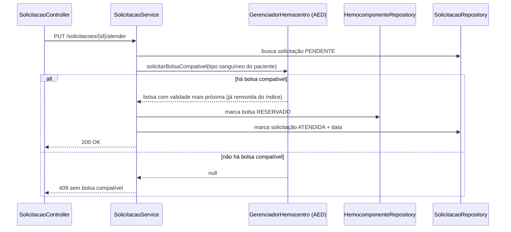

# Backlog Revisado — Unidade 2 (POO)

Projeto Integrador Rota Vital (Hemobit) — ADS, CESAR School
Disciplina: Programação Orientada a Objetos (camada de aplicação)
Card Jira: PI3E4-28 — W10 - Backlog revisado (POO)

---

## 1. Objetivo da Unidade 2

Na Unidade 1 entregamos o cadastro: doadores, hemocomponentes, unidades de saúde, solicitações, veículos e rotas, cada um com seu CRUD. Na Unidade 2 o foco muda: o sistema deixa de só guardar dados e passa a **tomar decisões** com eles, usando os módulos das outras disciplinas.

A POO é a camada que junta tudo: recebe o pedido do hospital, consulta o módulo de compatibilidade (AED), escolhe a bolsa certa e entrega os dados prontos para os painéis (EST).

Pesos da rubrica da disciplina na U2:

| Critério | Peso | Onde aparece neste backlog |
|---|---|---|
| Integração dos módulos | 40% | HU-U2-01, HU-U2-02, seções 5 e 6 |
| Regras de negócio (compatibilidade + FEFO) | 35% | HU-U2-01, HU-U2-03 |
| Testes e qualidade | 25% | Itens de teste e definição de pronto |

> A compatibilidade ABO/Rh usada aqui é didática e não substitui o protocolo clínico real.

---

## 2. Ponto de partida

### O que já existe (U1)

- Entidades: Doador, Doacao, Hemocomponente, Localidade (UnidadeColeta e UnidadeSaude), Solicitacao, Veiculo, Rota.
- Camadas `domain`, `repository`, `service` e `controller`, com DTO no Hemocomponente.
- CRUD completo de Doador, Hemocomponente, Solicitacao, UnidadeSaude, Veiculo e Rota.
- Pacote `aed` com Pilha, Fila, Lista Encadeada e `GerenciadorHemocentro`.
- Módulo de compatibilidade ABO/Rh do AED (PI3E4-29), com consultas em tempo constante.
- Benchmark de paralelismo (SO) e deploy no Render.

### Lacunas que a U2 precisa fechar

| # | Lacuna | Efeito |
|---|---|---|
| 1 | `Solicitacao` não guarda o tipo sanguíneo do paciente | Não dá para checar compatibilidade |
| 2 | `Hemocomponente` não tem tipo sanguíneo próprio (só chega nele via Doacao → Doador) | Consulta lenta e indireta |
| 3 | `PUT /solicitacoes/{id}/atender` só confere se existe bolsa DISPONIVEL do tipo; não usa ABO/Rh, FEFO nem reserva | Regra central do projeto ainda não existe |
| 4 | Nada marca bolsa como VENCIDO quando a validade passa | Estoque mostra bolsa vencida como disponível |
| 5 | `Transporte` e `TransporteHemocomponente` não foram implementados | Não há despacho |
| 6 | `Doacao` e `UnidadeColeta` só têm repository (sem service nem controller) | Não dá cadastrar doação pela API |
| 7 | `Solicitacao` não registra data de atendimento | EST não consegue calcular tempo de atendimento |
| 8 | Quase nenhum teste automatizado | Pesa nos 25% de testes e qualidade |
| 9 | Dois atendimentos ao mesmo tempo podem pegar a mesma bolsa | Risco de bolsa duplicada |

---

## 3. Histórias de usuário da U2

### HU-U2-01 — Atender solicitação com compatibilidade e validade

**Evolui:** HU06 e HU07. **Integra:** AED. **Prioridade:** Alta

> Como **profissional do hemocentro**, quero que o sistema escolha automaticamente uma bolsa **compatível** com o tipo sanguíneo do paciente e **mais próxima de vencer**, para atender a solicitação com segurança e reduzir o descarte.

Critérios de aceite (BDD):

```gherkin
Cenário: Atendimento com bolsa compatível
  Dado uma solicitação PENDENTE de paciente O negativo
  E existem bolsas DISPONIVEL do tipo pedido, compatíveis e não vencidas
  Quando o hemocentro atender a solicitação
  Então o sistema reserva a bolsa compatível com validade mais próxima
  E a bolsa passa para RESERVADO
  E a solicitação passa para ATENDIDA com a data de atendimento registrada

Cenário: Regra FEFO
  Dado duas bolsas compatíveis, uma vencendo em 3 dias e outra em 20 dias
  Quando a solicitação for atendida
  Então a bolsa que vence em 3 dias é a escolhida

Cenário: Incompatibilidade
  Dado uma solicitação de paciente A positivo
  E só existem bolsas B negativo em estoque
  Quando o hemocentro tentar atender
  Então o sistema responde 409 com mensagem clara
  E nenhuma bolsa muda de status

Cenário: Bolsa vencida nunca é escolhida
  Dado uma bolsa compatível com validade anterior a hoje
  Quando a solicitação for atendida
  Então essa bolsa é ignorada

Cenário: Solicitação já atendida
  Dado uma solicitação ATENDIDA
  Quando tentarem atender de novo
  Então o sistema responde 409
```

> A confirmar com o time: quando não há bolsa compatível, a solicitação continua PENDENTE (opção atual proposta) ou vira NEGADA?

### HU-U2-02 — Indicadores consolidados para os painéis

**Evolui:** HU05. **Integra:** EST. **Prioridade:** Alta

> Como **gestor do hemocentro**, quero ver indicadores de estoque, vencimento, demanda e descarte, para decidir onde agir antes de a bolsa vencer.

Critérios de aceite (BDD):

```gherkin
Cenário: Estoque por tipo
  Dado bolsas cadastradas em vários tipos e status
  Quando o painel consultar o estoque
  Então recebe a quantidade DISPONIVEL por tipo de hemocomponente e por tipo sanguíneo

Cenário: Faixas de vencimento
  Dado bolsas com validades variadas
  Quando o painel consultar os vencimentos
  Então cada bolsa aparece em uma faixa: VENCIDO, URGENTE (até 7 dias), ATENCAO (até 30 dias) ou OK

Cenário: Demanda por período
  Dado solicitações em datas diferentes
  Quando o painel informar início e fim
  Então recebe o total solicitado por tipo dentro do período

Cenário: Período inválido
  Quando o início for depois do fim
  Então o sistema responde 400
```

### HU-U2-03 — Despachar bolsas por rota e veículo

**Evolui:** modelo de domínio (Transporte). **Integra:** AED (rotas). **Prioridade:** Média

> Como **logística do hemocentro**, quero despachar as bolsas reservadas por uma rota usando um veículo disponível, para que cheguem ao hospital dentro da validade.

Critérios de aceite (BDD):

```gherkin
Cenário: Despacho válido
  Dado bolsas RESERVADO, uma rota entre hemocentro e hospital e um veículo DISPONIVEL com capacidade suficiente
  Quando o transporte for criado
  Então as bolsas passam para TRANSPORTANDO
  E o veículo passa para EM_ROTA

Cenário: Veículo indisponível ou pequeno demais
  Dado um veículo em MANUTENCAO ou com capacidade menor que a carga
  Quando tentarem despachar
  Então o sistema responde 409

Cenário: Bolsa vence antes de chegar
  Dado uma bolsa que vence antes do tempo estimado da rota
  Quando tentarem despachar
  Então o sistema recusa essa bolsa

Cenário: Chegada
  Dado um transporte em andamento
  Quando for concluído
  Então as bolsas ficam ENTREGUE, a localização passa a ser o hospital e o veículo volta a DISPONIVEL
```

> A confirmar com o time se a HU-U2-03 entra inteira na U2 ou se parte fica para a entrega final.

---

## 4. Backlog priorizado

| # | Item | História | Prioridade | Sprint alvo | Depende de |
|---|---|---|---|---|---|
| 1 | Ajustar modelo: tipo sanguíneo na Solicitacao e no Hemocomponente; data de atendimento na Solicitacao | HU-U2-01 | Alta | Week 12-13 | — |
| 2 | Service e controller de Doacao e UnidadeColeta | Base | Alta | Week 12-13 | — |
| 3 | Adaptador POO ↔ AED (carrega estoque, insere bolsa, consulta compatibilidade) | HU-U2-01 | Alta | Week 12-13 | #1, ajustes do AED (seção 5) |
| 4 | Atender solicitação com ABO/Rh + FEFO + reserva | HU-U2-01 | Alta | Week 12-13 | #1, #3 |
| 5 | Controle de concorrência na reserva da bolsa | HU-U2-01 | Alta | Week 12-13 | #4 |
| 6 | Rotina agendada que marca bolsas VENCIDO | HU-U2-02 | Média | Week 14-15 | #1 |
| 7 | Endpoints `/estatisticas/*` | HU-U2-02 | Alta | Week 14-15 | #4, #6, alinhamento com EST |
| 8 | CRUD de Transporte e TransporteHemocomponente | HU-U2-03 | Média | Week 14-15 | #4 |
| 9 | Validação de rota e validade com o grafo do AED | HU-U2-03 | Média | Week 14-15 | #8, AED |
| 10 | Testes automatizados (unitários e de integração) | Todas | Alta | contínuo | cada item |
| 11 | Conferir contratos da API com o RSD (`docs/rsd/`) | Todas | Média | Week 14-15 | #7, #8 |
| 12 | Versão final da POO (PI3E4-33) | Todas | Alta | Week 14-15 | #1–#11 |
| 13 | Entrega final integrada (PI3E4-38) | Todas | Alta | Week 16-18 | #12 |

---

## 5. Integração com AED

### O que o AED oferece hoje (código lido)

Pacote `com.hemobit.hemobit.aed`:

- `MatrizCompatibilidade.isCompativel(indiceReceptor, indiceDoador)`: matriz 8x8 de ABO/Rh. A ordem dos índices é A+, A-, B+, B-, AB+, AB-, O+, O-. Conferi as 8 linhas e estão corretas.
- `TabelaHashEstoque`: 8 gavetas (uma por tipo sanguíneo doador), cada uma com uma `FilaFEFO`.
  - `adicionar(Doacao)`, `retirar(String tipo)` e `retirarCompativel(String tipoReceptor)`.
- `GerenciadorHemocentro`: `registrarEntrada(Doacao)`, `solicitarBolsa(String)`, `solicitarBolsaCompativel(String)`, além do grafo de rotas (`adicionarLocalMapa`, `adicionarRota`, `calcularMelhorRota`).
- `Grafo`: Dijkstra para o caminho mais curto, por nome de local.

### O que isso significa para a POO

| Ponto | Situação no AED | Problema para a POO | Proposta |
|---|---|---|---|
| Unidade guardada | `Doacao` | O que reservamos e entregamos é o `Hemocomponente` (com tipo, validade e status) | AED passar a guardar `Hemocomponente` |
| Critério FEFO | Ordena por `Doacao.dataHora` (data da coleta) | FEFO é por **validade**; e a validade muda por tipo de hemocomponente | Ordenar por `Hemocomponente.dataValidade` |
| Tipo de hemocomponente | Não existe no AED | Pedido de plaquetas poderia receber hemácias | Uma tabela por tipo, ou filtrar no retorno |
| Validade | Não verifica | Pode devolver bolsa vencida | Descartar vencidas ao retirar (ou a POO tira do índice antes) |
| Tipo sanguíneo desconhecido | `default: return 0` (vira A+) | Erro silencioso: um tipo inválido seria tratado como A+ | Lançar exceção |
| Entrada do tipo | `String`, aceita "A+" ou "A_POSITIVO" | Funciona com `enum.name()`, mas é frágil | Receber o enum `TipoSanguineo` |
| Consulta de compatibilidade | Só dentro do `retirarCompativel` | A POO não consegue só perguntar "são compatíveis?" | Expor um método público de consulta |
| Retirada | Remove do índice na hora | Se o banco falhar depois, o índice perde a bolsa | POO recoloca a bolsa no índice se a transação falhar |
| Testes | `MatrizCompatibilidadeTest.java` está vazio | Pesa nos 25% de testes | Preencher (8x8 = 64 casos) |
| Concorrência | Sem proteção | Dois atendimentos simultâneos podem corromper a fila | Sincronizar o acesso no adaptador da POO |

A complexidade de `retirarCompativel` é constante (no máximo 8 gavetas). A inserção na `FilaFEFO` é linear no tamanho da gaveta, porque insere de forma ordenada. Vale ajustar a documentação de complexidade do AED.

### Como o Service chama o módulo



### Contrato proposto entre POO e AED

| Operação | Quem chama | O que faz |
|---|---|---|
| Carregar estoque | POO, na inicialização | Lê as bolsas DISPONIVEL do banco e chama `registrarEntrada` para cada uma |
| Inserir bolsa | POO, ao cadastrar ou receber bolsa | `registrarEntrada` |
| `solicitarBolsaCompativel` | POO, ao atender | Devolve a bolsa compatível mais próxima de vencer e a remove do índice |
| Consultar compatibilidade | POO, para validar ou informar | `MatrizCompatibilidade.isCompativel` (precisa de conversão enum → índice) |
| `calcularMelhorRota` | POO, ao despachar (HU-U2-03) | Caminho mais curto entre dois locais, pelo nome |

### Decisões a fechar com o AED

1. **Trocar `Doacao` por `Hemocomponente`** no índice, com FEFO por `dataValidade` (o ajuste principal). Isso exige o item 1 do backlog: tipo sanguíneo no `Hemocomponente`.
2. **Filtro por tipo de hemocomponente** (hemácias, plaquetas, plasma).
3. **Tipo desconhecido** deve dar erro, não A+.
4. **Fonte da verdade:** o banco. O AED é um índice em memória, reconstruído na inicialização (o plano gratuito do Render hiberna).
5. **Rotas:** o grafo usa nomes (`String`). A POO precisa carregar as `Rota` do banco para o grafo e usar o nome da `Localidade` como chave. Nomes repetidos quebrariam isso; combinar usar o `id`.

---

## 6. Integração com EST

### Como os painéis consomem os dados

Endpoints de leitura (GET), em JSON, datas no padrão ISO-8601, com DTOs próprios (nunca a entidade direto):

| Endpoint | Retorna |
|---|---|
| `/estatisticas/estoque` | Quantidade disponível por tipo de hemocomponente e tipo sanguíneo |
| `/estatisticas/vencimentos` | Bolsas por faixa: VENCIDO, URGENTE (até 7 dias), ATENCAO (até 30 dias), OK |
| `/estatisticas/demanda?inicio&fim` | Total solicitado por tipo no período |
| `/estatisticas/descarte?inicio&fim` | Bolsas VENCIDO e DESCARTADO no período e taxa de descarte |
| `/estatisticas/tempo-atendimento?inicio&fim` | Tempo médio entre criação e atendimento da solicitação |

Massa inicial de dados: `data/estoque.json` e `data/requisicoes.json`, para o EST trabalhar enquanto o banco ainda tem poucos registros.

> A confirmar com o EST: lista final de indicadores, nomes dos campos e período padrão.

---

## 7. Outros pontos de integração

- **RSD:** contratos da API em `docs/rsd/contratos-api.md` e `docs/rsd/especificacao-api.md` precisam ser atualizados sempre que um endpoint novo for criado.
- **SO:** a reserva de bolsa precisa ser segura com acessos simultâneos (item 5). A detecção de vencimento do benchmark pode inspirar a rotina agendada do item 6.

---

## 8. Cronograma por sprint

| Sprint | Período | Foco da POO |
|---|---|---|
| Week 10-11 | 7 a 16 out | Este backlog (PI3E4-28) |
| Week 12-13 | 19 a 30 out | Itens 1 a 5: modelo, CRUDs faltantes, adaptador com AED, atendimento com ABO/Rh + FEFO, concorrência |
| Week 14-15 | 2 a 13 nov | Itens 6 a 9 e 11: vencimento, estatísticas, transporte, contratos; versão final (PI3E4-33) |
| Week 16-18 | 16 nov a 4 dez | Ajustes, testes finais e entrega final integrada (PI3E4-38) |

---

## 9. Riscos

| Risco | Impacto | Como reduzir |
|---|---|---|
| AED guarda `Doacao` e ordena por data da coleta, não por validade | Regra FEFO errada | Combinar a troca para `Hemocomponente` na Week 12 |
| Contrato do AED mudar depois de começarmos | Retrabalho no adaptador | Isolar o AED atrás de uma classe adaptadora única |
| EST pedir indicador que o modelo não suporta | Atraso | Fechar a lista de indicadores na Week 12 |
| Render hibernar e perder índice em memória | Estoque do AED vazio | Reconstruir o índice a partir do banco na inicialização |
| Pouco tempo para testes | Perda nos 25% da rubrica | Escrever teste junto de cada item, não no fim |
| HU-U2-03 grande demais | Atrasar as histórias altas | Priorizar HU-U2-01 e HU-U2-02; HU-U2-03 pode ser entregue por partes |

---

## 10. Definição de pronto

Um item só é considerado pronto quando:

- o código está na branch principal, compila e roda com `.\mvnw.cmd clean compile`;
- segue as camadas controller → service → repository e usa DTO na API;
- tem testes automatizados cobrindo o caminho feliz e os erros principais (400, 404, 409);
- o contrato do endpoint está documentado em `docs/`;
- foi conferido com a disciplina integrada (AED, EST, SO ou RSD), quando houver;
- o card no Jira está atualizado.

---

## 11. Pendências de alinhamento

- [ ] **AED:** combinar as decisões da seção 5 (guardar `Hemocomponente`, FEFO por validade, filtro por tipo de hemocomponente, erro para tipo desconhecido, teste da matriz vazio).
- [ ] **EST:** lista final de indicadores e formato do JSON.
- [ ] **Time:** a HU-U2-03 entra inteira na U2? Sem bolsa compatível, a solicitação fica PENDENTE ou vira NEGADA?
- [ ] **Jira:** criar os cards da POO nas sprints Week 12-13 e 14-15, a partir do backlog da seção 4.
- [ ] **README:** definir a data da Entrega 03.
