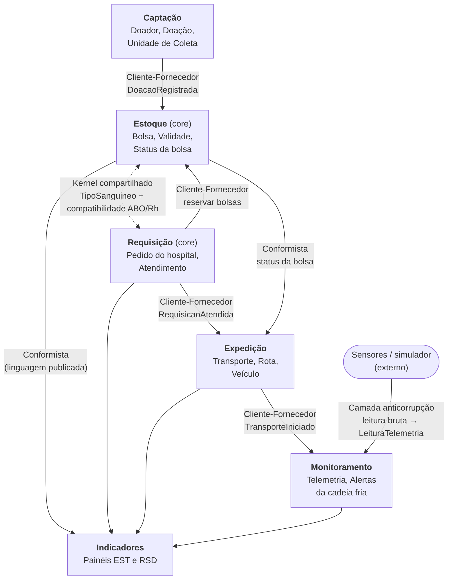
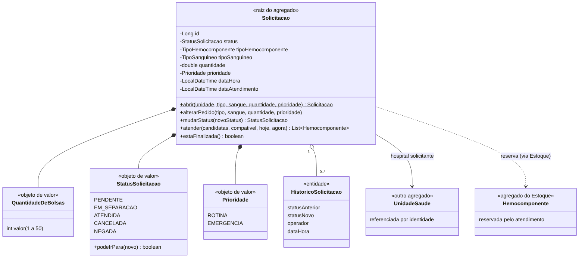
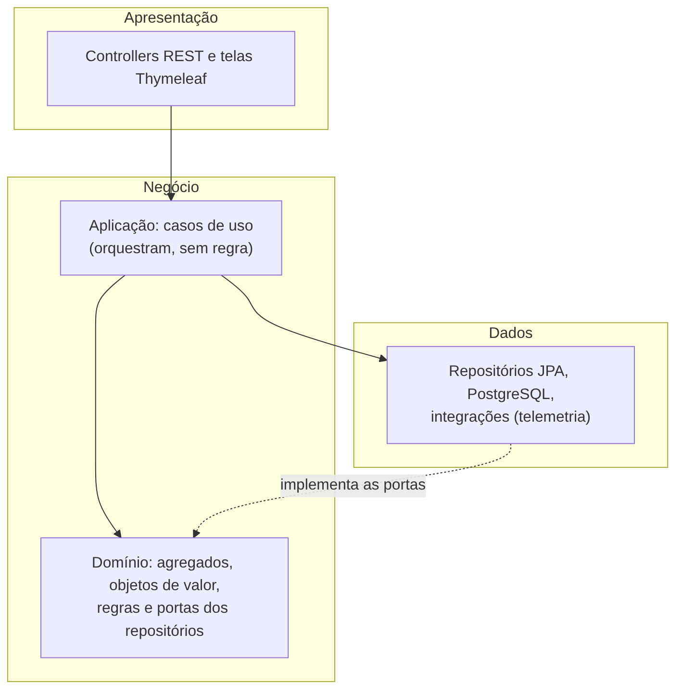
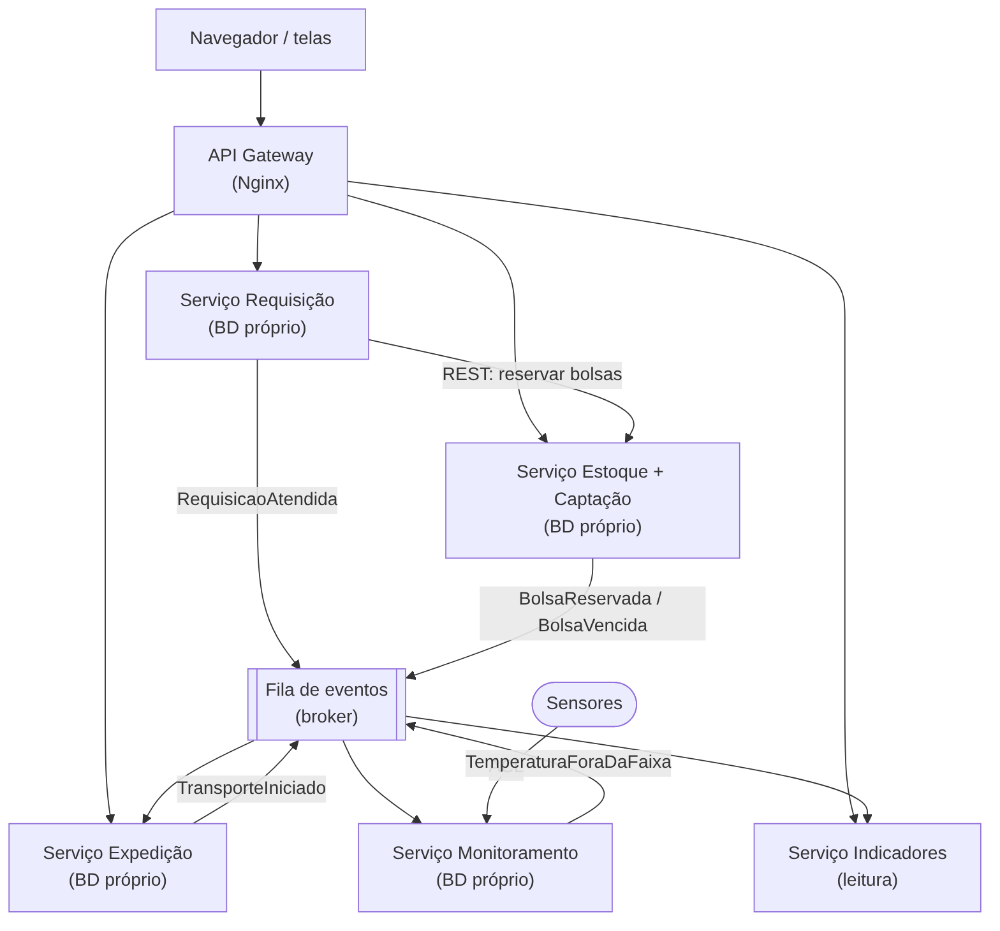
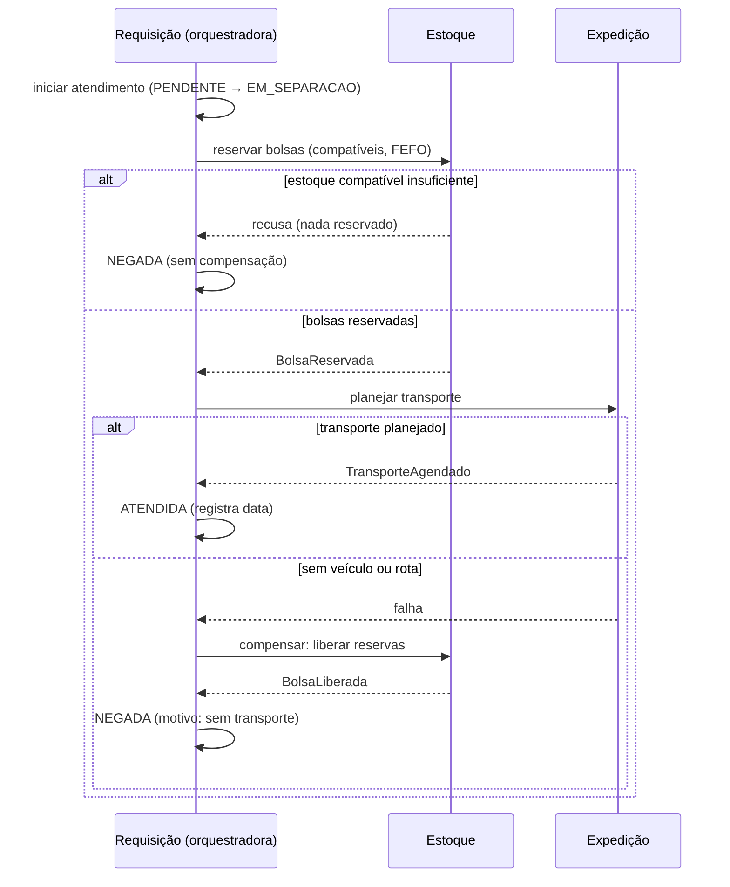
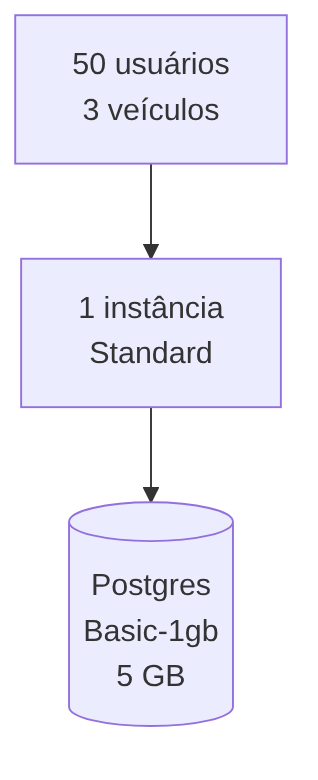
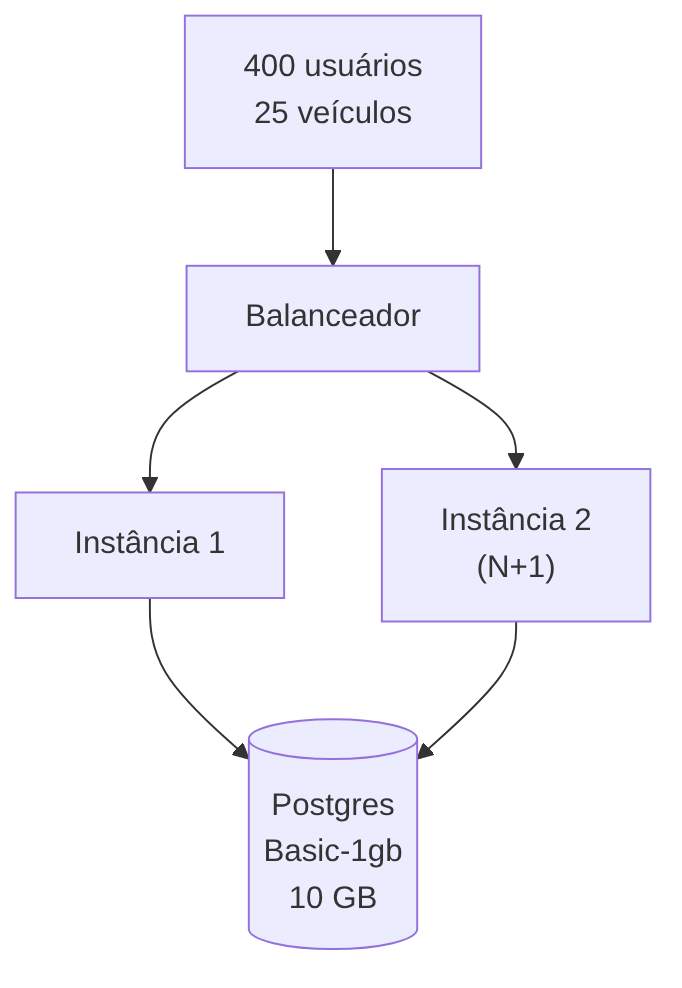
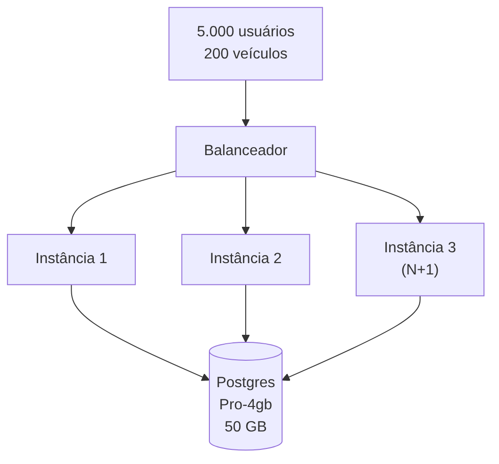

# Hemobit: planejamento da remodelagem

<div class="capa">

**Squad:** Grupo 5, ADS, CESAR School · **Disciplina:** Infraestrutura de Software · **Trabalho U2, Parte 2**<br>
**Integrantes:** Breno Luiz de Lima Cruz, Davi Magno Campelo do Nascimento, Lauan Goncalves dos Santos, Letícia Gomes da Silva, Lucas Felipe Barreto Cavalcante, Lucas Filipe de Lima Segundo, Mateus Valerino Barros de Santana<br>
**Repositório:** https://github.com/brenocrruz/projeto-hemobit · **Artefatos:** `docs/so/arquitetura/` (diagramas, planilha `orcamento-hemobit.xlsx` e ADRs em `docs/so/arquitetura/adr/`)

</div>

## A. Remodelagem do domínio com DDD

### A.1 Subdomínios

O Hemobit distribui hemocomponentes de hemocentros para hospitais. O que diferencia o sistema é decidir **qual bolsa atende qual paciente, com segurança e sem desperdício**, e entregá-la com a cadeia fria íntegra.

| Subdomínio | Classe | Justificativa |
|---|---|---|
| Atendimento de requisições | **Core** | É a regra que o projeto vende: escolher a bolsa compatível (ABO/Rh) e mais próxima do vencimento (FEFO) e reservá-la sem duplicidade. |
| Estoque e validade | **Core** | A vida útil curta de cada hemocomponente e o ciclo de status da bolsa são regras específicas deste negócio, e o atendimento depende delas. |
| Logística e rotas | Suporte | Necessária para entregar, mas o grafo de rotas e o cadastro de veículos são problemas conhecidos, sem diferencial competitivo. |
| Monitoramento da cadeia fria | Suporte | Gera alertas de temperatura durante o transporte; apoia a segurança, mas não decide o atendimento. |
| Captação (doadores e doações) | Suporte | Alimenta o estoque; o cadastro segue fluxo administrativo comum. |
| Indicadores e análise | Suporte | Painéis de estoque, demanda e tempos leem dados dos outros contextos e não têm regra própria. |
| Identidade e acesso | Genérico | Autenticação e perfis são resolvidos por soluções prontas (ainda não implementado no projeto). |
| Notificação e chatbot | Genérico | Envio de avisos e atendimento por conversa podem usar serviços prontos. |
| Hospedagem e observabilidade | Genérico | Docker, Render, GitHub Actions e métricas são infraestrutura padrão. |

### A.2 Bounded contexts

| Contexto | Responsabilidade (uma frase) |
|---|---|
| **Estoque** | Guarda cada bolsa com seu código, validade e status, e garante que só bolsa disponível e dentro da validade possa ser reservada. |
| **Requisição** | Recebe o pedido do hospital e o atende escolhendo bolsas compatíveis pela ordem de validade, registrando o histórico de status. |
| **Expedição** | Planeja a rota, escolhe o veículo e acompanha o transporte das bolsas reservadas até o hospital. |
| **Captação** | Cadastra doadores, doações e unidades de coleta, e entrega ao Estoque a origem de cada bolsa. |
| **Monitoramento** | Recebe leituras de temperatura e posição durante o transporte e emite alerta quando a cadeia fria é rompida. |
| **Indicadores** | Reúne, sem alterar, os dados dos demais contextos para os painéis de estoque, demanda e tempo de atendimento. |

### A.3 Glossário da linguagem ubíqua

Os nomes em código estão entre parênteses quando diferem do termo de negócio.

| Termo | Contexto | Significado |
|---|---|---|
| **Bolsa** | Estoque | Unidade física de hemocomponente, com código único, validade e status (`Hemocomponente` no código). |
| **Bolsa** | Expedição | Item de carga de um transporte: interessa o destino, a temperatura exigida e o horário de entrega, não a validade. |
| **Bolsa** | Requisição | Item reservado para atender um pedido; só importa se é compatível e quantas faltam. |
| **Tipo sanguíneo** | Captação | Grupo ABO/Rh do doador, informado na doação. |
| **Tipo sanguíneo** | Estoque | Grupo da bolsa, herdado do doador da doação de origem. |
| **Tipo sanguíneo** | Requisição | Grupo do paciente (receptor), que decide a compatibilidade. |
| **Status** | Estoque | Situação da bolsa: Disponível, Reservado, Transportando, Utilizado, Vencido ou Descartado. |
| **Status** | Requisição | Situação do pedido: Pendente, Em separação, Atendida, Cancelada ou Negada. |
| Hemocomponente (tipo) | Estoque | Categoria do produto: concentrado de hemácias, plaquetas, plasma, crioprecipitado, sangue total. |
| Código da bolsa | Estoque | Identificador único, sempre em maiúsculas e sem espaços nas pontas. |
| Validade | Estoque | Data limite de uso; bolsa vencida não pode ser reservada. |
| FEFO | Requisição | "Primeiro que vence, primeiro que sai": entre as bolsas compatíveis, usa-se a mais próxima do vencimento. |
| Compatibilidade ABO/Rh | Requisição e Estoque | Regra didática que diz quais bolsas um paciente pode receber (matriz 8x8 do módulo de AED). |
| Reserva | Estoque | Ato de separar uma bolsa para um pedido; a bolsa passa a Reservada e fica ligada à requisição. |
| Requisição (`Solicitacao`) | Requisição | Pedido de um hospital por determinada quantidade de um hemocomponente para um paciente. |
| Prioridade | Requisição | Urgência do pedido: rotina ou emergência. |
| Atendimento | Requisição | Ato de reservar as bolsas e concluir o pedido, registrando a data. |
| Doação | Captação | Coleta de sangue de um doador, em uma unidade de coleta, da qual saem as bolsas. |
| Unidade de saúde | Requisição e Expedição | Hospital que pede e recebe as bolsas. |
| Rota | Expedição | Caminho entre origem e destino, com distância e tempo estimado. |
| Cadeia fria | Monitoramento | Faixa de temperatura que deve ser mantida do estoque até o hospital. |
| Alerta de temperatura | Monitoramento | Aviso gerado quando uma leitura sai da faixa permitida. |

### A.4 Mapa de contextos



| Relação | Tipo | Como funciona |
|---|---|---|
| Captação → Estoque | Cliente-Fornecedor | Captação é a fornecedora: cada doação registrada origina bolsas no Estoque. |
| Requisição → Estoque | Cliente-Fornecedor | Requisição é cliente: pede a reserva de bolsas e aceita as regras de disponibilidade que o Estoque define. |
| Estoque ↔ Requisição | Kernel compartilhado | Os dois usam o mesmo `TipoSanguineo` e a mesma matriz de compatibilidade ABO/Rh, mantidos em um único lugar. |
| Requisição → Expedição | Cliente-Fornecedor | Um pedido atendido dispara o planejamento do transporte. |
| Estoque → Expedição | Conformista | Expedição aceita o modelo de status da bolsa do Estoque sem traduzi-lo. |
| Expedição → Monitoramento | Cliente-Fornecedor | O início de um transporte diz ao Monitoramento o que acompanhar. |
| Sensores → Monitoramento | Camada anticorrupção | A leitura bruta do sensor (ou do simulador) é traduzida para `LeituraTelemetria`, protegendo o domínio do formato externo. |
| Demais → Indicadores | Conformista | Indicadores consome os dados como estão publicados e não influencia os outros contextos. |

**Opcional: eventos de domínio** (nome no passado, quem publica, quem consome)

| Evento | Publica | Consome |
|---|---|---|
| `DoacaoRegistrada` | Captação | Estoque |
| `BolsaRegistrada` | Estoque | Indicadores |
| `BolsaReservada` | Estoque | Requisição, Expedição, Indicadores |
| `BolsaVencida` | Estoque | Indicadores |
| `RequisicaoAtendida` | Requisição | Expedição, Indicadores |
| `RequisicaoNegada` | Requisição | Indicadores |
| `TransporteIniciado` | Expedição | Monitoramento, Estoque (bolsa passa a Transportando) |
| `TemperaturaForaDaFaixa` | Monitoramento | Expedição, Estoque, Indicadores |

**Situação atual:** o sistema é um monolito. Os contextos existem como separação de responsabilidades (por exemplo, `Solicitacao` chama `Hemocomponente.reservarPara` e usa `CompatibilidadeService`), ainda sem fronteira de pacote nem eventos.

## B. Modelo tático de um contexto core

O contexto escolhido é **Requisição**, core do Hemobit. O agregado é a **Requisição**, que no código se chama `Solicitacao`.

### B.1 O agregado Requisição



| Elemento | Papel no agregado |
|---|---|
| `Solicitacao` | **Raiz.** Única porta de entrada: nenhum código externo altera o estado sem passar por um comando da raiz. Não há setters públicos. |
| `HistoricoSolicitacao` | **Entidade interna.** Registra cada mudança de status (anterior, novo, operador e data e hora). Só existe ligada a uma requisição. |
| `QuantidadeDeBolsas` | **Objeto de valor.** Quantidade inteira de 1 a 50, imutável. Hoje a entidade grava o valor como número e usa o objeto para validar, o que mantém o esquema do banco. |
| `StatusSolicitacao` | **Objeto de valor (enum).** Conhece o próprio ciclo de vida por `podeIrPara`. |
| `Prioridade` | **Objeto de valor (enum).** Rotina ou emergência. |
| `TipoHemocomponente` e `TipoSanguineo` | **Valores.** O tipo sanguíneo (do paciente) vem do kernel compartilhado. |
| `UnidadeSaude` | **Outro agregado**, referenciada pelo hospital solicitante. |
| `Hemocomponente` (bolsa) | **Agregado do Estoque.** O atendimento o reserva, mas ele não pertence a este agregado. |

**Invariantes que a raiz protege**

| # | Invariante | Onde é garantida |
|---|---|---|
| I1 | A quantidade é um número inteiro de bolsas entre 1 e 50. | `Solicitacao.abrir`, `alterarPedido` e `QuantidadeDeBolsas` |
| I2 | Tipo de hemocomponente, tipo sanguíneo do paciente e prioridade são obrigatórios. | `abrir` e `alterarPedido` |
| I3 | Toda requisição pertence a uma unidade de saúde. | `abrir` |
| I4 | Só uma requisição PENDENTE pode ser editada. | `alterarPedido` |
| I5 | O status segue o ciclo: PENDENTE → EM_SEPARAÇÃO, CANCELADA ou NEGADA; EM_SEPARAÇÃO → CANCELADA ou NEGADA. Requisição finalizada (ATENDIDA, CANCELADA, NEGADA) não muda mais, e ATENDIDA só se alcança pelo comando `atender`. | `mudarStatus`, `StatusSolicitacao.podeIrPara` |
| **I6** | **O atendimento reserva apenas bolsas compatíveis com o paciente, na ordem de validade (FEFO), e é tudo ou nada: se faltar bolsa compatível, nenhuma é reservada e a requisição continua como estava.** | `atender` |
| I7 | Ao atender, a requisição passa a ATENDIDA com a data do atendimento. | `atender` |

**Limite do modelo hoje:** para atender, a raiz chama `reservarPara` nas bolsas, ou seja, altera outro agregado na mesma transação. Isso é aceitável no monólito, porque o banco garante a atomicidade. Na projeção com microsserviços (seção D) essa chamada vira uma etapa de saga.

### B.2 História de usuário âncora

> **Como** enfermeira coordenadora da central de transfusão de um hospital, **quero** que o pedido de bolsas seja atendido apenas com sangue compatível com o paciente e com as bolsas mais próximas do vencimento, **para** transfundir com segurança e evitar que bolsas vençam no estoque.

**Ligada à invariante I6** (e às I1 e I7).

**Critérios de aceite**

1. Dado um pedido para paciente A+, o sistema reserva somente bolsas compatíveis (A+ ou O-, entre outras) e ignora as incompatíveis, como B+.
2. Entre as bolsas compatíveis, o sistema reserva as de validade mais próxima, deixando as de validade mais distante disponíveis.
3. Se o estoque compatível for menor que a quantidade pedida, o sistema recusa o atendimento com a mensagem de estoque insuficiente, nenhuma bolsa é reservada e a requisição continua PENDENTE.
4. Quando o atendimento conclui, a requisição fica ATENDIDA com a data e a hora do atendimento registradas, e cada bolsa reservada fica ligada ao pedido.
5. Um pedido de mais de 50 bolsas é recusado antes de qualquer reserva.

Cada critério é verificado por teste automatizado, em `SolicitacaoTest` ou nos cenários Cucumber.

### B.3 Cenário Gherkin

```gherkin
# language: pt
Funcionalidade: Atendimento de solicitação de hemocomponentes

  Cenário: Atender reservando as bolsas compatíveis mais próximas do vencimento
    Dado uma solicitação de 2 bolsas de concentrado de hemácias para paciente "A_POSITIVO"
    E as seguintes bolsas disponíveis em ordem de validade:
      | codigo | tipoSanguineo |
      | B-001  | B_POSITIVO    |
      | B-002  | O_NEGATIVO    |
      | B-003  | A_POSITIVO    |
      | B-004  | A_POSITIVO    |
    Quando a solicitação é atendida
    Então as bolsas "B-002, B-003" ficam reservadas
    E a bolsa "B-001" continua disponível
    E a bolsa "B-004" continua disponível
    E a solicitação fica com status "ATENDIDA"
```

Este cenário já executa com Cucumber no repositório (`src/test/resources/features/atendimento-solicitacao.feature`, steps em `AtendimentoSteps`) e roda na esteira de CI. A mesma funcionalidade tem outros dois cenários: estoque insuficiente (critério 3) e pedido acima de 50 bolsas (critério 5).

## C. Arquitetura em três camadas

### C.1 O que fica em cada camada



| Camada | O que contém | Exemplos no Hemobit |
|---|---|---|
| **Apresentação** | Controllers REST, telas Thymeleaf, DTOs de entrada e saída, tratamento de erros HTTP. Converte requisição em chamada de caso de uso e resposta em JSON ou tela. | `SolicitacaoController`, `HemocomponenteController`, página `/atendimento` |
| **Negócio, aplicação** | Casos de uso: um método por intenção do usuário. Busca os agregados, chama o domínio, salva e registra histórico. Não decide regra de negócio. | `AtenderRequisicao`, `RegistrarBolsa` (hoje `SolicitacaoService` e `HemocomponenteService`) |
| **Negócio, domínio** | Agregados, entidades, objetos de valor, regras e invariantes, e as interfaces (portas) dos repositórios. | `Solicitacao`, `Hemocomponente`, `CodigoBolsa`, `QuantidadeDeBolsas`, `PeriodoDeValidade` |
| **Dados** | Repositórios JPA que implementam as portas, banco PostgreSQL e integrações externas. | `SolicitacaoRepository`, `HemocomponenteRepository`, entrada de telemetria |

### C.2 Regra de dependência

1. A apresentação só chama a aplicação; a aplicação só usa o domínio e as portas dos repositórios; a camada de dados só implementa essas portas.
2. O modelo de domínio não importa controller, DTO, classe de repositório nem tipo do Spring Web.
3. A camada de negócio não conhece a de dados por classe concreta: ela declara a interface e o Spring injeta a implementação (inversão de dependência). Assim "cada camada usa só a de baixo" continua verdadeiro em tempo de execução, e o domínio fica testável sem banco, como mostram os testes de domínio e os cenários Cucumber que já rodam na esteira.
4. A regra será verificada automaticamente por um teste de arquitetura (ArchUnit) na Parte 3.

**Desvio conhecido:** as entidades hoje têm anotações do JPA (`jakarta.persistence`). Aceitamos como compromisso por ora, porque são metadados de persistência e não trazem Spring Web nem lógica de banco para dentro do domínio. A separação completa entre modelo de domínio e modelo de persistência fica registrada como evolução, pelo custo de manter dois modelos num projeto deste tamanho.

### C.3 Estrutura de pacotes proposta

Hoje os pacotes são por camada (`controller`, `service`, `repository`, `domain`, `dto`). A proposta passa a organizar por contexto e, dentro dele, por camada:

```
com.hemobit.hemobit
├── estoque
│   ├── apresentacao     (HemocomponenteController, EstoqueController, EstoqueOpcoesController)
│   ├── negocio
│   │   ├── aplicacao    (RegistrarBolsa, CorrigirDadosDaBolsa, ConsultarEstoque)
│   │   └── dominio      (Hemocomponente [Bolsa], CodigoBolsa, PeriodoDeValidade,
│   │                     StatusHemocomponente, TipoHemocomponente, BolsaRepository)
│   └── dados            (BolsaRepositoryJpa)
├── requisicao
│   ├── apresentacao     (SolicitacaoController, JornadaPageController)
│   ├── negocio
│   │   ├── aplicacao    (AbrirRequisicao, AtenderRequisicao, AlterarStatusDaRequisicao)
│   │   └── dominio      (Solicitacao [Requisição], QuantidadeDeBolsas, StatusSolicitacao,
│   │                     Prioridade, HistoricoSolicitacao, RequisicaoRepository)
│   └── dados            (RequisicaoRepositoryJpa, HistoricoRepositoryJpa)
├── expedicao
│   ├── apresentacao     (RotaController, RotaApiController, VeiculoController)
│   ├── negocio
│   │   ├── aplicacao    (PlanejarRota, CadastrarVeiculo)
│   │   └── dominio      (Rota, Veiculo, StatusVeiculo)
│   └── dados            (RotaRepositoryJpa, VeiculoRepositoryJpa)
├── captacao
│   ├── apresentacao     (DoadorController, CadastroApiController)
│   ├── negocio
│   │   ├── aplicacao    (RegistrarDoacao, CadastrarDoador)
│   │   └── dominio      (Doador, Doacao, UnidadeColeta)
│   └── dados            (DoadorRepositoryJpa, DoacaoRepositoryJpa)
├── monitoramento
│   ├── apresentacao     (TelemetriaController, TelemetriaWebSocketHandler)
│   ├── negocio
│   │   ├── aplicacao    (IngerirLeitura)
│   │   └── dominio      (LeituraTelemetria, AlertaTemperatura)
│   └── dados            (SimuladorTelemetria: camada anticorrupção)
├── indicadores
│   ├── apresentacao     (IndicadoresController, DashboardController)
│   └── negocio.aplicacao (ConsultarIndicadores, EstatisticaService)
└── compartilhado        (TipoSanguineo, CompatibilidadeService/MatrizCompatibilidade,
                          Localidade, UnidadeSaude)
```

Os nomes entre colchetes mostram a tradução entre o termo de negócio e o nome atual no código. O pacote `compartilhado` é o kernel compartilhado do mapa de contextos.

**Como migrar:** `Estoque` e `Requisição` primeiro, por serem os contextos core e já terem domínio rico (`Hemocomponente` e `Solicitacao` sem setters, com objetos de valor e testes). Os demais contextos seguem depois, sem mexer nos contratos HTTP.

### C.4 Camada lógica × tier físico

| Camada lógica | Onde roda hoje |
|---|---|
| Apresentação (telas Thymeleaf e controllers REST) | Gerada no servidor, dentro do mesmo processo Spring Boot; o navegador só exibe o HTML e executa o JavaScript das telas. |
| Negócio (aplicação e domínio) | No mesmo processo Spring Boot, em um único container Docker. |
| Dados (repositórios e banco) | Os repositórios JPA rodam dentro desse processo; o PostgreSQL roda em outro container (no `compose.yaml`) ou em outro serviço, ligado por `SPRING_DATASOURCE_URL` (no Render). |

| Tier físico | Conteúdo |
|---|---|
| 1. Cliente | Navegador do profissional de saúde. |
| 2. Aplicação | Um container com a aplicação Spring Boot, por trás do Nginx (no compose, três redes: pública, aplicação e banco). |
| 3. Dados | Um container (ou serviço) PostgreSQL, em rede interna sem rota para fora. |

**Diferença na prática:** temos três camadas lógicas, mas uma única unidade de deploy para elas, a imagem Docker da aplicação. Separar em camadas é uma decisão de código; separar em tiers é uma decisão de infraestrutura. O banco já é um tier à parte, e as três camadas lógicas só virariam tiers diferentes se o Hemobit fosse decomposto em serviços (seção D).

*Pendente para a versão final: confirmar com o grupo que o banco do Render é o PostgreSQL gerenciado e ajustar a tabela acima.*

## D. Projeção com microsserviços

Esta seção é um **projeto**, não uma mudança de código: o squad decide, no ADR 0002, manter o monólito modular na Parte 3.

### D.1 Quais contextos viram serviços e por quê

| Serviço | Contextos | Por que é um serviço separado |
|---|---|---|
| **Estoque** | Estoque e Captação | Dono do estado das bolsas e de toda a regra de validade e reserva. Captação entra junto: é pequeno, muda pouco e só alimenta o estoque. |
| **Requisição** | Requisição | Core do negócio e dono do ciclo de vida do pedido. Recebe picos de pedidos de hospitais e orquestra o atendimento. |
| **Expedição** | Expedição | Tem ritmo e dados próprios (rotas, veículos) e pode evoluir sem tocar no estoque. |
| **Monitoramento** | Monitoramento | Recebe muitas leituras de sensores e precisa escalar de forma independente do resto. |
| **Indicadores** | Indicadores | Só lê dados publicados por eventos, sem regra própria; pode falhar ou atrasar sem afetar o atendimento. |

Ficam **juntos** Estoque e Captação, porque separar contextos que mudam juntos só traria custo de rede e de operação.



### D.2 Comunicação

| Situação | Mecanismo | Motivo |
|---|---|---|
| Telas consultam estoque, requisições, rotas | REST síncrono | O usuário espera a resposta na hora. |
| Requisição pede a reserva de bolsas ao Estoque | REST síncrono (`POST /reservas`) | A resposta (reservadas ou recusa) decide o próximo passo da saga. Quem escolhe as bolsas é o Estoque, aplicando compatibilidade e FEFO. |
| Fatos que interessam a outros contextos (`RequisicaoAtendida`, `BolsaVencida`, `TransporteIniciado`, `TemperaturaForaDaFaixa`) | Eventos em fila (broker) | Quem publica não precisa conhecer quem consome, e uma falha de um consumidor não derruba o atendimento. |

**Cuidados:** consumidores idempotentes (a mesma mensagem pode chegar duas vezes) e publicação de eventos pelo padrão **outbox** (o evento é gravado na mesma transação da mudança e publicado depois), para não perder evento quando o serviço cai entre gravar e publicar.

### D.3 Dados

- **Um banco por serviço.** Nenhum serviço lê a tabela do outro, e não há junção entre serviços.
- Na prática, nos cenários de custo baixo, os cinco bancos podem ser **esquemas separados** na mesma instância PostgreSQL, com usuários diferentes; no cenário alto, instâncias separadas.
- A referência entre serviços é feita por **identificador** (por exemplo, a bolsa guarda `requisicaoId`), e dados de consulta frequente de outro contexto (nome e localização do hospital) são copiados por evento.
- O **kernel compartilhado** (`TipoSanguineo` e a matriz de compatibilidade) vira uma biblioteca versionada usada por Estoque e Requisição.
- **Consistência:** dentro de um serviço, transação do banco; entre serviços, consistência eventual coordenada por saga.

### D.4 Saga do atendimento

Fluxo que atravessa três contextos: atender a requisição, reservar as bolsas e planejar o transporte. A **Requisição orquestra** os passos.



| Passo | Serviço | Ação | Compensação se um passo seguinte falhar |
|---|---|---|---|
| 1 | Requisição | Muda para EM_SEPARAÇÃO | Muda para NEGADA com o motivo (transição já permitida pelo ciclo de vida) |
| 2 | Estoque | Reserva as bolsas compatíveis, por FEFO, tudo ou nada | **Libera as reservas**: as bolsas voltam a DISPONÍVEL e o evento `BolsaLiberada` é publicado |
| 3 | Expedição | Planeja a rota e aloca um veículo | Cancela o transporte planejado, se houver |
| 4 | Requisição | Muda para ATENDIDA e registra a data | (último passo, sem compensação) |

**Falhas tratadas:**

- *Estoque compatível insuficiente* no passo 2: nada foi reservado, então basta marcar a requisição como NEGADA.
- *Sem veículo ou rota* no passo 3: a compensação libera as bolsas e a requisição vira NEGADA com o motivo "sem transporte disponível".
- *Timeout* de um serviço: o orquestrador repete a chamada (o passo é idempotente pelo `requisicaoId`) e, esgotadas as tentativas, executa a compensação.

**Por que orquestração e não coreografia:** o fluxo tem poucos passos e uma ordem clara, e o estado da saga fica visível em um só lugar (a própria requisição), o que facilita depurar e explicar.

### D.5 Opcional: o que seria serverless

| Parte | Serverless? | Motivo |
|---|---|---|
| Emitir a guia ou o comprovante quando a requisição é atendida | **Sim** | É curta, sem estado, disparada por evento e tolera cold start. |
| Processar leituras de telemetria em lote e gerar alertas | **Sim, com ressalvas** | Funciona bem por evento, mas muitas conexões simultâneas exigem pool ou proxy de conexões no banco. |
| Atender a requisição (reserva de bolsas) | **Não** | Exige transação no banco e baixa latência previsível, e o cold start atrapalharia o pedido de emergência. |
| Serviço de Estoque inteiro | **Não** | Tem estado e conexões persistentes com o banco. |

### D.6 Monólito modular × microsserviços (× serverless)

| Critério | Monólito modular | Microsserviços | Serverless (partes) |
|---|---|---|---|
| Unidade de deploy | Uma imagem Docker | Uma imagem por serviço, mais broker e gateway | Uma função por evento |
| Escala | Escala tudo junto | Escala cada serviço conforme a carga | Escala por invocação, até zero |
| Consistência dos dados | Transação única e forte | Eventual entre serviços, com saga e compensação | Eventual; funções sem estado |
| Custo | Menor: uma instância e um banco | Maior: várias instâncias, bancos e broker, mesmo com pouca carga | Paga por uso; barato com carga baixa, pode encarecer com carga contínua |
| Complexidade de operação | Baixa: um pipeline e um log | Alta: observabilidade distribuída, versões, falhas de rede | Média: limites de tempo e de conexões, cold start |

### D.7 ADRs

Os dois ADRs estão em `docs/so/arquitetura/adr/`:

- `0001-decomposicao.md`: a decomposição adotada na projeção.
- `0002-monolito-modular-na-parte-3.md`: a escolha do squad para a implementação.

## E. Três cenários com orçamento

Os números desta seção estão na planilha `orcamento-hemobit.xlsx` (abas Premissas, Little, Orcamento e Fontes). Mudar uma premissa recalcula tudo. As premissas são do squad e usam apenas dados sintéticos; elas devem ser trocadas por medições reais da aplicação (o `MetricasHttpFilter` já mede as requisições) assim que houver.

### E.1 Premissas de carga

| Premissa | Baixo (piloto) | Moderado (regional) | Alto (estadual) |
|---|---|---|---|
| Usuários cadastrados | 50 | 400 | 5.000 |
| Hospitais atendidos | 5 | 40 | 300 |
| Pedidos de bolsas por dia | 100 | 2.000 | 30.000 |
| Requisições HTTP por pedido | 25 | 25 | 25 |
| Veículos com telemetria (1 leitura a cada 10 s) | 3 | 25 | 200 |
| **Pico de requisições por segundo (com rajada ×3)** | **1,3** | **15,8** | **185** |
| Disponibilidade desejada | 99% | 99,5% | 99,9% |

**Como o pico foi obtido:** 20% das requisições do dia caem na hora de pico; sobre esse valor aplica-se um fator de rajada de 3, para cobrir picos de emergência. A telemetria é somada à parte (veículos ÷ 10 s) e também recebe o fator de rajada.

### E.2 Conta da Lei de Little

Lei de Little: **L = λ × W**, em que L é o número de requisições simultâneas no sistema, λ é a taxa de chegada (req/s) e W é o tempo médio que cada requisição passa no sistema (s). Premissas de tempo: W = 0,25 s nas requisições interativas e 0,05 s na telemetria. Capacidade de 20 requisições simultâneas por instância.

**Exemplo, cenário Alto:**

- Interativo: λ = 41,67 req/s (pico) × 3 = 125 req/s. L = 125 × 0,25 = **31,25**.
- Telemetria: λ = 200 ÷ 10 = 20 req/s × 3 = 60 req/s. L = 60 × 0,05 = **3,0**.
- L total = 34,25. Instâncias = ⌈34,25 ÷ 20⌉ = **2**. Com uma instância extra para redundância (N+1): **3**.
- Banco: 100 consultas/s × 0,06 s + 60 leituras/s × 0,02 s = **7,2** conexões ocupadas em média. Com utilização alvo de 50% do pool: ⌈7,2 ÷ 0,5⌉ = **15** conexões, ou 5 por instância.

| Resultado | Baixo | Moderado | Alto |
|---|---|---|---|
| λ total no pico (req/s) | 1,32 | 15,83 | 185,0 |
| L total (requisições simultâneas) | 0,15 | 2,46 | 34,25 |
| Instâncias pela conta | 1 | 1 | 2 |
| **Instâncias com redundância** | **1** | **2** | **3** |
| Conexões ocupadas com o banco (média) | 0,04 | 0,55 | 7,2 |
| **Conexões totais máximas (pool)** | **5** | **10** | **15** |

**Leitura dos resultados:** nos cenários baixo e moderado a carga cabe em uma instância, e a segunda do moderado existe por disponibilidade, não por capacidade. No alto, a conta pede duas instâncias e a redundância leva a três. Como o limite de conexões do plano do banco precisa comportar o pool total, confirme-o na documentação da Render antes de contratar (a página de preços consultada não o informa).

### E.3 Diagrama por cenário e o que muda

| Baixo | Moderado | Alto |
|:---:|:---:|:---:|
|  |  |  |

| O que muda | Baixo → Moderado | Moderado → Alto |
|---|---|---|
| Instâncias da aplicação | 1 → 2: a segunda dá redundância (99,5%) | 2 → 3: a conta pede 2 e a redundância soma 1 |
| Banco | Mesmo plano, mais armazenamento | Plano maior (Pro-4gb) e 50 GB, por causa da telemetria e do volume de pedidos |
| Arquitetura | Monólito modular | Continua monólito modular, conforme o ADR 0002 |
| Equipe e conta | Workspace gratuito → workspace para equipes | Igual |

**Sobre decompor em microsserviços:** a Lei de Little não exige serviços separados nem no cenário alto, porque o monólito com 3 instâncias absorve a carga. A decomposição só se justificaria por outro motivo, como isolar falhas ou separar equipes. A tabela do orçamento mostra o preço dessa escolha.

### E.4 Orçamento por cenário

Preços on-demand, em dólar, da PaaS Render, consultados em **21/11/2026**. Fonte: página de preços da Render (https://render.com/pricing; o conteúdo foi lido em render-web.onrender.com/pricing). Região: a página não informa; confirmar no painel do serviço.

| Cenário | Item | Qtd. | Preço unitário (USD/mês) | Custo mensal (USD) |
|---|---|---|---|---|
| Baixo | Web service Standard (2 GB RAM, 1 CPU) | 1 | 25,00 | 25,00 |
| Baixo | Render Postgres Basic-1gb | 1 | 19,00 | 19,00 |
| Baixo | Armazenamento do Postgres (GB) | 5 | 0,30 | 1,50 |
| Baixo | Workspace gratuito | 1 | 0,00 | 0,00 |
| | **Total do cenário baixo** | | | **45,50** |
| | Pedidos por mês: 3.000 · **custo por pedido** | | | **US$ 0,0152** |
| Moderado | Web service Standard | 2 | 25,00 | 50,00 |
| Moderado | Render Postgres Basic-1gb | 1 | 19,00 | 19,00 |
| Moderado | Armazenamento do Postgres (GB) | 10 | 0,30 | 3,00 |
| Moderado | Workspace para equipes pequenas (por usuário) | 2 | 19,00 | 38,00 |
| | **Total do cenário moderado** | | | **110,00** |
| | Pedidos por mês: 60.000 · **custo por pedido** | | | **US$ 0,0018** |
| Alto | Web service Standard | 3 | 25,00 | 75,00 |
| Alto | Render Postgres Pro-4gb (4 GB RAM, 1 CPU) | 1 | 55,00 | 55,00 |
| Alto | Armazenamento do Postgres (GB) | 50 | 0,30 | 15,00 |
| Alto | Workspace para equipes pequenas (por usuário) | 2 | 19,00 | 38,00 |
| | **Total do cenário alto** | | | **183,00** |
| | Pedidos por mês: 900.000 · **custo por pedido** | | | **US$ 0,0002** |

**Sensibilidade, alto com cinco microsserviços** (10 instâncias Standard, 2 bancos Pro-4gb, 3 bancos Basic-1gb, 50 GB e 2 usuários): **US$ 470,00 por mês**, ou **US$ 0,0005 por pedido**, ou seja, cerca de 2,6 vezes o custo do monólito modular, sem contar o broker de mensagens, cujo preço não foi consultado.

**Leitura:** o custo mensal sobe de US$ 45,50 para US$ 183,00 (4 vezes), mas os pedidos sobem 300 vezes, então o custo por pedido cai de US$ 0,0152 para US$ 0,0002.

**O que o orçamento não cobre:**

- Excedente de tráfego de saída: no cenário alto são cerca de 112,5 GB por mês contra 100 GB incluídos, e o preço do excedente não consta na página consultada.
- Alta disponibilidade do banco: no cenário alto (99,9%) o PostgreSQL de instância única é o ponto único de falha, e a opção de redundância não foi orçada.
- Backups extras, domínio, monitoramento externo e impostos.
- Escalar para várias instâncias pode exigir workspace pago; o orçamento já usa o pago nos cenários moderado e alto.

## Uso de IA

**Ferramenta:** Claude (Anthropic), usado como assistente de código e de redação. Os dados usados são apenas os dados sintéticos do Hemobit. A IA não foi usada como fonte de preços: todo valor do orçamento foi lido na página de preços da Render e conferido pelo squad.

| Parte | Finalidade do uso da IA | Como foi validada |
|---|---|---|
| A. Domínio com DDD | Rascunhar a classificação dos subdomínios, os contextos, o glossário e o mapa de contextos a partir das classes e do backlog do projeto. | O squad comparou cada termo e cada contexto com as classes do repositório e com o backlog, e ajustou o que não correspondia ao código. |
| B. Modelo tático | Levantar as invariantes da `Solicitacao` a partir do código e redigir a história âncora e o cenário Gherkin. | As invariantes foram conferidas contra os métodos da entidade. O cenário Gherkin executa com Cucumber e os testes de domínio rodam na esteira de CI, que passou antes do merge. |
| C. Três camadas | Propor a divisão em camadas, a estrutura de pacotes por contexto e a distinção entre camada lógica e tier físico. | Revisão do squad contra os pacotes reais e contra o `compose.yaml` e o deploy no Render. Os desvios conhecidos (anotações JPA no domínio) foram declarados no texto. |
| D. Microsserviços | Esboçar a decomposição, a comunicação, a saga e os dois ADRs. | Revisão do squad: a saga foi checada contra o ciclo de vida de `StatusSolicitacao` (a compensação usa uma transição já permitida) e o ADR 0002 foi discutido e aceito pelo grupo. |
| E. Cenários e orçamento | Montar a planilha com fórmulas, a conta da Lei de Little e as tabelas de custo. | A planilha foi recalculada sem erros de fórmula. A conta do cenário alto foi refeita à mão. Os preços foram conferidos pelo squad em https://render.com/pricing. As premissas de carga são do squad e estão marcadas como tais. |
| Código da Parte 3 | Escrever a refatoração do domínio (`Hemocomponente` e `Solicitacao`), os objetos de valor, os testes e a configuração do Cucumber e do JaCoCo. | Testes automatizados na esteira de CI (`mvn verify`), cobertura medida pelo JaCoCo, revisão no pull request e execução local pelo squad antes do merge. |

**Declaração:** todo conteúdo produzido com auxílio de IA foi lido, executado ou conferido pelo squad antes de entrar neste documento ou na branch `main`.
