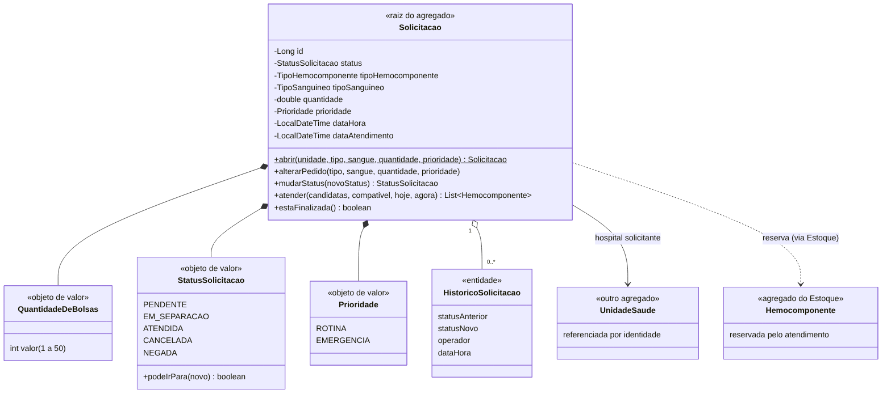

## B. Modelo tático de um contexto core

O contexto escolhido é **Requisição**, core do Hemobit. O agregado é a **Requisição**, que no código se chama `Solicitacao`.

### B.1 O agregado Requisição



| Elemento | Papel no agregado |
|---|---|
| `Solicitacao` | **Raiz.** Única porta de entrada: nenhum código externo altera o estado sem passar por um comando da raiz. Não há setters públicos. |
| `HistoricoSolicitacao` | **Entidade interna.** Registra cada mudança de status (anterior, novo, operador e data e hora). Só existe ligada a uma requisição. |
| `QuantidadeDeBolsas` | **Objeto de valor.** Quantidade inteira de 1 a 50, imutável. Hoje a entidade grava o valor como número e usa o objeto para validar, o que mantém o esquema do banco. |
| `StatusSolicitacao` | **Objeto de valor (enum).** Conhece o próprio ciclo de vida por `podeIrPara`. |
| `Prioridade` | **Objeto de valor (enum).** Rotina ou emergência. |
| `TipoHemocomponente` e `TipoSanguineo` | **Valores.** O tipo sanguíneo (do paciente) vem do kernel compartilhado. |
| `UnidadeSaude` | **Outro agregado**, referenciada pelo hospital solicitante. |
| `Hemocomponente` (bolsa) | **Agregado do Estoque.** O atendimento o reserva, mas ele não pertence a este agregado. |

**Invariantes que a raiz protege**

| # | Invariante | Onde é garantida |
|---|---|---|
| I1 | A quantidade é um número inteiro de bolsas entre 1 e 50. | `Solicitacao.abrir`, `alterarPedido` e `QuantidadeDeBolsas` |
| I2 | Tipo de hemocomponente, tipo sanguíneo do paciente e prioridade são obrigatórios. | `abrir` e `alterarPedido` |
| I3 | Toda requisição pertence a uma unidade de saúde. | `abrir` |
| I4 | Só uma requisição PENDENTE pode ser editada. | `alterarPedido` |
| I5 | O status segue o ciclo: PENDENTE → EM_SEPARAÇÃO, CANCELADA ou NEGADA; EM_SEPARAÇÃO → CANCELADA ou NEGADA. Requisição finalizada (ATENDIDA, CANCELADA, NEGADA) não muda mais, e ATENDIDA só se alcança pelo comando `atender`. | `mudarStatus`, `StatusSolicitacao.podeIrPara` |
| **I6** | **O atendimento reserva apenas bolsas compatíveis com o paciente, na ordem de validade (FEFO), e é tudo ou nada: se faltar bolsa compatível, nenhuma é reservada e a requisição continua como estava.** | `atender` |
| I7 | Ao atender, a requisição passa a ATENDIDA com a data do atendimento. | `atender` |

**Limite do modelo hoje:** para atender, a raiz chama `reservarPara` nas bolsas, ou seja, altera outro agregado na mesma transação. Isso é aceitável no monólito, porque o banco garante a atomicidade. Na projeção com microsserviços (seção D) essa chamada vira uma etapa de saga.

### B.2 História de usuário âncora

> **Como** enfermeira coordenadora da central de transfusão de um hospital, **quero** que o pedido de bolsas seja atendido apenas com sangue compatível com o paciente e com as bolsas mais próximas do vencimento, **para** transfundir com segurança e evitar que bolsas vençam no estoque.

**Ligada à invariante I6** (e às I1 e I7).

**Critérios de aceite**

1. Dado um pedido para paciente A+, o sistema reserva somente bolsas compatíveis (A+ ou O-, entre outras) e ignora as incompatíveis, como B+.
2. Entre as bolsas compatíveis, o sistema reserva as de validade mais próxima, deixando as de validade mais distante disponíveis.
3. Se o estoque compatível for menor que a quantidade pedida, o sistema recusa o atendimento com a mensagem de estoque insuficiente, nenhuma bolsa é reservada e a requisição continua PENDENTE.
4. Quando o atendimento conclui, a requisição fica ATENDIDA com a data e a hora do atendimento registradas, e cada bolsa reservada fica ligada ao pedido.
5. Um pedido de mais de 50 bolsas é recusado antes de qualquer reserva.

Cada critério é verificado por teste automatizado, em `SolicitacaoTest` ou nos cenários Cucumber.

### B.3 Cenário Gherkin

```gherkin
# language: pt
Funcionalidade: Atendimento de solicitação de hemocomponentes

  Cenário: Atender reservando as bolsas compatíveis mais próximas do vencimento
    Dado uma solicitação de 2 bolsas de concentrado de hemácias para paciente "A_POSITIVO"
    E as seguintes bolsas disponíveis em ordem de validade:
      | codigo | tipoSanguineo |
      | B-001  | B_POSITIVO    |
      | B-002  | O_NEGATIVO    |
      | B-003  | A_POSITIVO    |
      | B-004  | A_POSITIVO    |
    Quando a solicitação é atendida
    Então as bolsas "B-002, B-003" ficam reservadas
    E a bolsa "B-001" continua disponível
    E a bolsa "B-004" continua disponível
    E a solicitação fica com status "ATENDIDA"
```

Este cenário já executa com Cucumber no repositório (`src/test/resources/features/atendimento-solicitacao.feature`, steps em `AtendimentoSteps`) e roda na esteira de CI. A mesma funcionalidade tem outros dois cenários: estoque insuficiente (critério 3) e pedido acima de 50 bolsas (critério 5).
