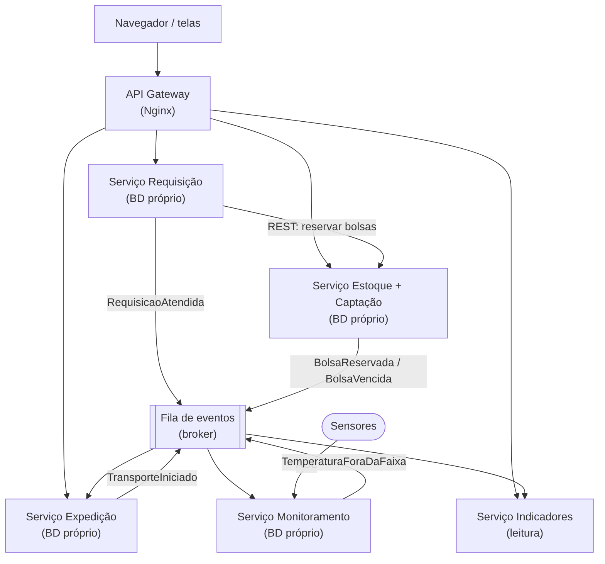
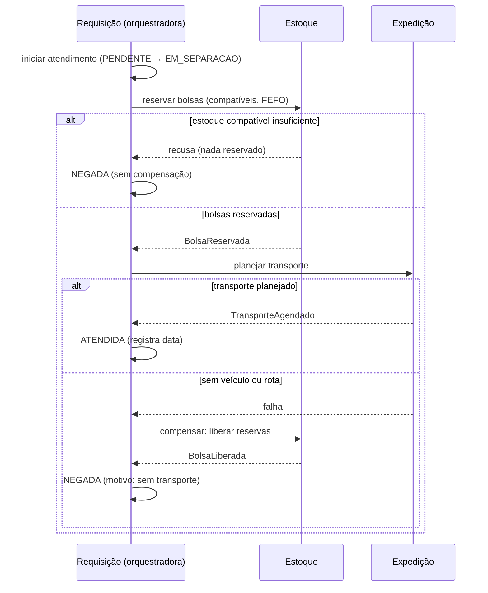

## D. Projeção com microsserviços

Esta seção é um **projeto**, não uma mudança de código: o squad decide, no ADR 0002, manter o monólito modular na Parte 3.

### D.1 Quais contextos viram serviços e por quê

| Serviço | Contextos | Por que é um serviço separado |
|---|---|---|
| **Estoque** | Estoque e Captação | Dono do estado das bolsas e de toda a regra de validade e reserva. Captação entra junto: é pequeno, muda pouco e só alimenta o estoque. |
| **Requisição** | Requisição | Core do negócio e dono do ciclo de vida do pedido. Recebe picos de pedidos de hospitais e orquestra o atendimento. |
| **Expedição** | Expedição | Tem ritmo e dados próprios (rotas, veículos) e pode evoluir sem tocar no estoque. |
| **Monitoramento** | Monitoramento | Recebe muitas leituras de sensores e precisa escalar de forma independente do resto. |
| **Indicadores** | Indicadores | Só lê dados publicados por eventos, sem regra própria; pode falhar ou atrasar sem afetar o atendimento. |

Ficam **juntos** Estoque e Captação, porque separar contextos que mudam juntos só traria custo de rede e de operação.

### D.2 Comunicação

| Situação | Mecanismo | Motivo |
|---|---|---|
| Telas consultam estoque, requisições, rotas | REST síncrono | O usuário espera a resposta na hora. |
| Requisição pede a reserva de bolsas ao Estoque | REST síncrono (`POST /reservas`) | A resposta (reservadas ou recusa) decide o próximo passo da saga. Quem escolhe as bolsas é o Estoque, aplicando compatibilidade e FEFO. |
| Fatos que interessam a outros contextos (`RequisicaoAtendida`, `BolsaVencida`, `TransporteIniciado`, `TemperaturaForaDaFaixa`) | Eventos em fila (broker) | Quem publica não precisa conhecer quem consome, e uma falha de um consumidor não derruba o atendimento. |

**Cuidados:** consumidores idempotentes (a mesma mensagem pode chegar duas vezes) e publicação de eventos pelo padrão **outbox** (o evento é gravado na mesma transação da mudança e publicado depois), para não perder evento quando o serviço cai entre gravar e publicar.

### D.3 Dados

- **Um banco por serviço.** Nenhum serviço lê a tabela do outro, e não há junção entre serviços.
- Na prática, nos cenários de custo baixo, os cinco bancos podem ser **esquemas separados** na mesma instância PostgreSQL, com usuários diferentes; no cenário alto, instâncias separadas.
- A referência entre serviços é feita por **identificador** (por exemplo, a bolsa guarda `requisicaoId`), e dados de consulta frequente de outro contexto (nome e localização do hospital) são copiados por evento.
- O **kernel compartilhado** (`TipoSanguineo` e a matriz de compatibilidade) vira uma biblioteca versionada usada por Estoque e Requisição.
- **Consistência:** dentro de um serviço, transação do banco; entre serviços, consistência eventual coordenada por saga.

### D.4 Saga do atendimento

Fluxo que atravessa três contextos: atender a requisição, reservar as bolsas e planejar o transporte. A **Requisição orquestra** os passos.

| Passo | Serviço | Ação | Compensação se um passo seguinte falhar |
|---|---|---|---|
| 1 | Requisição | Muda para EM_SEPARAÇÃO | Muda para NEGADA com o motivo (transição já permitida pelo ciclo de vida) |
| 2 | Estoque | Reserva as bolsas compatíveis, por FEFO, tudo ou nada | **Libera as reservas**: as bolsas voltam a DISPONÍVEL e o evento `BolsaLiberada` é publicado |
| 3 | Expedição | Planeja a rota e aloca um veículo | Cancela o transporte planejado, se houver |
| 4 | Requisição | Muda para ATENDIDA e registra a data | (último passo, sem compensação) |

**Falhas tratadas:**

- *Estoque compatível insuficiente* no passo 2: nada foi reservado, então basta marcar a requisição como NEGADA.
- *Sem veículo ou rota* no passo 3: a compensação libera as bolsas e a requisição vira NEGADA com o motivo "sem transporte disponível".
- *Timeout* de um serviço: o orquestrador repete a chamada (o passo é idempotente pelo `requisicaoId`) e, esgotadas as tentativas, executa a compensação.

**Por que orquestração e não coreografia:** o fluxo tem poucos passos e uma ordem clara, e o estado da saga fica visível em um só lugar (a própria requisição), o que facilita depurar e explicar.

### D.5 Opcional: o que seria serverless

| Parte | Serverless? | Motivo |
|---|---|---|
| Emitir a guia ou o comprovante quando a requisição é atendida | **Sim** | É curta, sem estado, disparada por evento e tolera cold start. |
| Processar leituras de telemetria em lote e gerar alertas | **Sim, com ressalvas** | Funciona bem por evento, mas muitas conexões simultâneas exigem pool ou proxy de conexões no banco. |
| Atender a requisição (reserva de bolsas) | **Não** | Exige transação no banco e baixa latência previsível, e o cold start atrapalharia o pedido de emergência. |
| Serviço de Estoque inteiro | **Não** | Tem estado e conexões persistentes com o banco. |

### D.6 Monólito modular × microsserviços (× serverless)

| Critério | Monólito modular | Microsserviços | Serverless (partes) |
|---|---|---|---|
| Unidade de deploy | Uma imagem Docker | Uma imagem por serviço, mais broker e gateway | Uma função por evento |
| Escala | Escala tudo junto | Escala cada serviço conforme a carga | Escala por invocação, até zero |
| Consistência dos dados | Transação única e forte | Eventual entre serviços, com saga e compensação | Eventual; funções sem estado |
| Custo | Menor: uma instância e um banco | Maior: várias instâncias, bancos e broker, mesmo com pouca carga | Paga por uso; barato com carga baixa, pode encarecer com carga contínua |
| Complexidade de operação | Baixa: um pipeline e um log | Alta: observabilidade distribuída, versões, falhas de rede | Média: limites de tempo e de conexões, cold start |

### D.7 ADRs

Os dois ADRs estão em `docs/so/arquitetura/adr/`:

- `0001-decomposicao.md`: a decomposição adotada na projeção.
- `0002-monolito-modular-na-parte-3.md`: a escolha do squad para a implementação.
