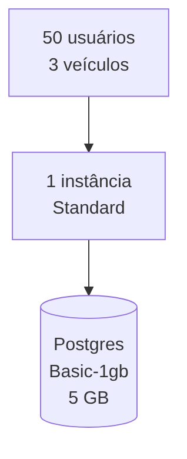
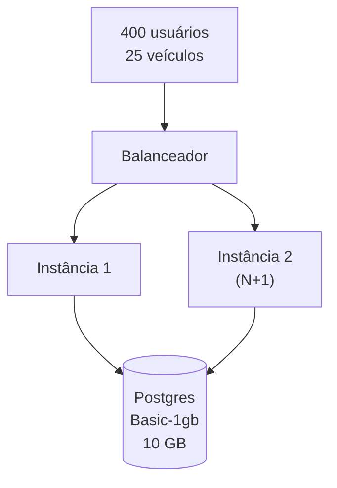
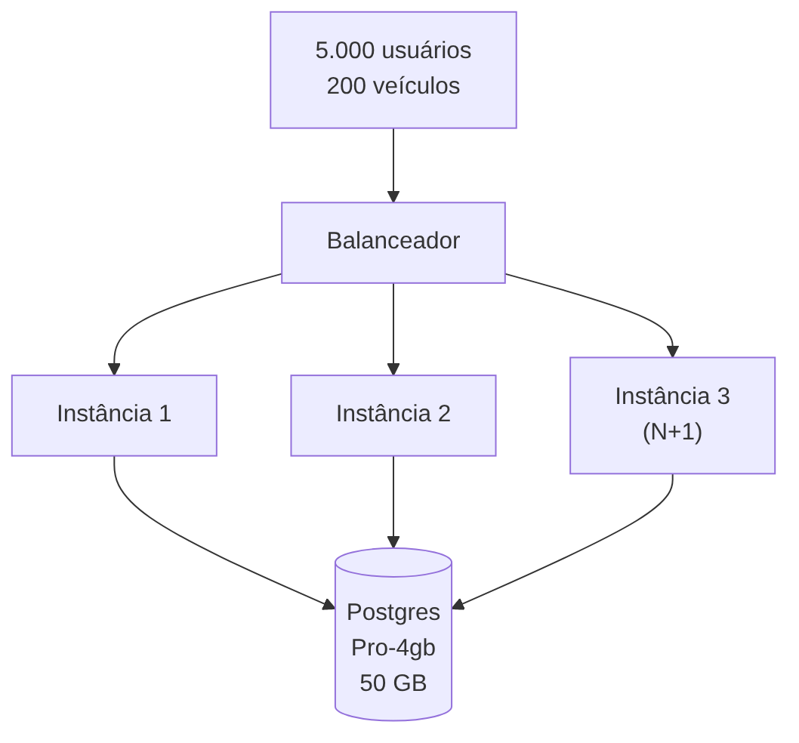

## E. Três cenários com orçamento

Os números desta seção estão na planilha `orcamento-hemobit.xlsx` (abas Premissas, Little, Orcamento e Fontes). Mudar uma premissa recalcula tudo. As premissas são do squad e usam apenas dados sintéticos; elas devem ser trocadas por medições reais da aplicação (o `MetricasHttpFilter` já mede as requisições) assim que houver.

### E.1 Premissas de carga

| Premissa | Baixo (piloto) | Moderado (regional) | Alto (estadual) |
|---|---|---|---|
| Usuários cadastrados | 50 | 400 | 5.000 |
| Hospitais atendidos | 5 | 40 | 300 |
| Pedidos de bolsas por dia | 100 | 2.000 | 30.000 |
| Requisições HTTP por pedido | 25 | 25 | 25 |
| Veículos com telemetria (1 leitura a cada 10 s) | 3 | 25 | 200 |
| **Pico de requisições por segundo (com rajada ×3)** | **1,3** | **15,8** | **185** |
| Disponibilidade desejada | 99% | 99,5% | 99,9% |

**Como o pico foi obtido:** 20% das requisições do dia caem na hora de pico; sobre esse valor aplica-se um fator de rajada de 3, para cobrir picos de emergência. A telemetria é somada à parte (veículos ÷ 10 s) e também recebe o fator de rajada.

### E.2 Conta da Lei de Little

Lei de Little: **L = λ × W**, em que L é o número de requisições simultâneas no sistema, λ é a taxa de chegada (req/s) e W é o tempo médio que cada requisição passa no sistema (s). Premissas de tempo: W = 0,25 s nas requisições interativas e 0,05 s na telemetria. Capacidade de 20 requisições simultâneas por instância.

**Exemplo, cenário Alto:**

- Interativo: λ = 41,67 req/s (pico) × 3 = 125 req/s. L = 125 × 0,25 = **31,25**.
- Telemetria: λ = 200 ÷ 10 = 20 req/s × 3 = 60 req/s. L = 60 × 0,05 = **3,0**.
- L total = 34,25. Instâncias = ⌈34,25 ÷ 20⌉ = **2**. Com uma instância extra para redundância (N+1): **3**.
- Banco: 100 consultas/s × 0,06 s + 60 leituras/s × 0,02 s = **7,2** conexões ocupadas em média. Com utilização alvo de 50% do pool: ⌈7,2 ÷ 0,5⌉ = **15** conexões, ou 5 por instância.

| Resultado | Baixo | Moderado | Alto |
|---|---|---|---|
| λ total no pico (req/s) | 1,32 | 15,83 | 185,0 |
| L total (requisições simultâneas) | 0,15 | 2,46 | 34,25 |
| Instâncias pela conta | 1 | 1 | 2 |
| **Instâncias com redundância** | **1** | **2** | **3** |
| Conexões ocupadas com o banco (média) | 0,04 | 0,55 | 7,2 |
| **Conexões totais máximas (pool)** | **5** | **10** | **15** |

**Leitura dos resultados:** nos cenários baixo e moderado a carga cabe em uma instância, e a segunda do moderado existe por disponibilidade, não por capacidade. No alto, a conta pede duas instâncias e a redundância leva a três. Como o limite de conexões do plano do banco precisa comportar o pool total, confirme-o na documentação da Render antes de contratar (a página de preços consultada não o informa).

### E.3 Diagrama por cenário e o que muda

| Baixo | Moderado | Alto |
|:---:|:---:|:---:|
|  |  |  |

| O que muda | Baixo → Moderado | Moderado → Alto |
|---|---|---|
| Instâncias da aplicação | 1 → 2: a segunda dá redundância (99,5%) | 2 → 3: a conta pede 2 e a redundância soma 1 |
| Banco | Mesmo plano, mais armazenamento | Plano maior (Pro-4gb) e 50 GB, por causa da telemetria e do volume de pedidos |
| Arquitetura | Monólito modular | Continua monólito modular, conforme o ADR 0002 |
| Equipe e conta | Workspace gratuito → workspace para equipes | Igual |

**Sobre decompor em microsserviços:** a Lei de Little não exige serviços separados nem no cenário alto, porque o monólito com 3 instâncias absorve a carga. A decomposição só se justificaria por outro motivo, como isolar falhas ou separar equipes. A tabela do orçamento mostra o preço dessa escolha.

### E.4 Orçamento por cenário

Preços on-demand, em dólar, da PaaS Render, consultados em **21/11/2026**. Fonte: página de preços da Render (https://render.com/pricing; o conteúdo foi lido em render-web.onrender.com/pricing). Região: a página não informa; confirmar no painel do serviço.

| Cenário | Item | Qtd. | Preço unitário (USD/mês) | Custo mensal (USD) |
|---|---|---|---|---|
| Baixo | Web service Standard (2 GB RAM, 1 CPU) | 1 | 25,00 | 25,00 |
| Baixo | Render Postgres Basic-1gb | 1 | 19,00 | 19,00 |
| Baixo | Armazenamento do Postgres (GB) | 5 | 0,30 | 1,50 |
| Baixo | Workspace gratuito | 1 | 0,00 | 0,00 |
| | **Total do cenário baixo** | | | **45,50** |
| | Pedidos por mês: 3.000 · **custo por pedido** | | | **US$ 0,0152** |
| Moderado | Web service Standard | 2 | 25,00 | 50,00 |
| Moderado | Render Postgres Basic-1gb | 1 | 19,00 | 19,00 |
| Moderado | Armazenamento do Postgres (GB) | 10 | 0,30 | 3,00 |
| Moderado | Workspace para equipes pequenas (por usuário) | 2 | 19,00 | 38,00 |
| | **Total do cenário moderado** | | | **110,00** |
| | Pedidos por mês: 60.000 · **custo por pedido** | | | **US$ 0,0018** |
| Alto | Web service Standard | 3 | 25,00 | 75,00 |
| Alto | Render Postgres Pro-4gb (4 GB RAM, 1 CPU) | 1 | 55,00 | 55,00 |
| Alto | Armazenamento do Postgres (GB) | 50 | 0,30 | 15,00 |
| Alto | Workspace para equipes pequenas (por usuário) | 2 | 19,00 | 38,00 |
| | **Total do cenário alto** | | | **183,00** |
| | Pedidos por mês: 900.000 · **custo por pedido** | | | **US$ 0,0002** |

**Sensibilidade, alto com cinco microsserviços** (10 instâncias Standard, 2 bancos Pro-4gb, 3 bancos Basic-1gb, 50 GB e 2 usuários): **US$ 470,00 por mês**, ou **US$ 0,0005 por pedido**, ou seja, cerca de 2,6 vezes o custo do monólito modular, sem contar o broker de mensagens, cujo preço não foi consultado.

**Leitura:** o custo mensal sobe de US$ 45,50 para US$ 183,00 (4 vezes), mas os pedidos sobem 300 vezes, então o custo por pedido cai de US$ 0,0152 para US$ 0,0002.

**O que o orçamento não cobre:**

- Excedente de tráfego de saída: no cenário alto são cerca de 112,5 GB por mês contra 100 GB incluídos, e o preço do excedente não consta na página consultada.
- Alta disponibilidade do banco: no cenário alto (99,9%) o PostgreSQL de instância única é o ponto único de falha, e a opção de redundância não foi orçada.
- Backups extras, domínio, monitoramento externo e impostos.
- Escalar para várias instâncias pode exigir workspace pago; o orçamento já usa o pago nos cenários moderado e alto.
